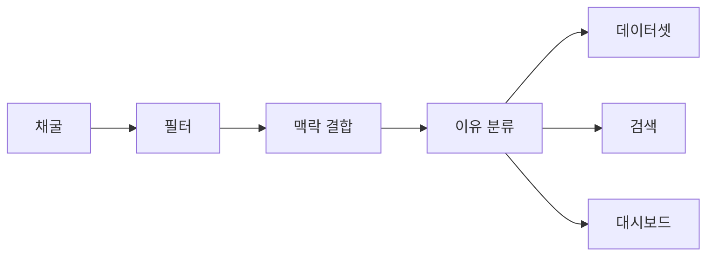

# Deleted Code Search — 지워진 코드 검색엔진

**성공은 검색되고, 실패는 삭제된다. 우리는 삭제된 코드를 검색한다.**
*Search the code open source deleted — and why it was deleted.*

[](LICENSE)
[](datasets/dataset-v0.9/README.md)
[](pyproject.toml)

코드 검색과 AI 코딩 도구는 살아남은 코드만 봅니다. "이렇게 해 봤는데 이래서 버렸다"는 지식은 커밋 히스토리에 묻혀 있습니다.
이 프로젝트는 오픈소스 Python 저장소 100개에서 **지워진 함수**를 모아, **왜 지워졌는지**와 **대신 무엇이 들어왔는지**를 함께 찾아 줍니다.
결과물은 공개 데이터셋, 통계 대시보드, 키워드·의미 검색입니다. 단국대 소프트웨어학과 캡스톤디자인(2026-09 ~ 2026-11) 프로젝트입니다.

| 대시보드 | 의미 검색 |
|---|---|
|  |  |

## 숫자로 보기

| 항목 | 결과 | 출처 |
|---|---:|---|
| 저장소 | **100개** | [데이터셋 문서](datasets/dataset-v0.9/README.md) |
| 삭제 함수 → 의미 있는 삭제 | 5,383,893 (538만) → **1,354,052 (135만)** | [대시보드 집계](docs/reports/dashboard_stats.json) |
| 이유 분류 8종 | **73.0%** (4묶음 85.0%, 게이트 2 60.0%에서 개선) | [분류기 개선](docs/reports/classifier_improvement.md) |
| 의미 검색 P@10 | **0.625** (키워드 0.325) | [검색 관련성](docs/reports/search_relevance.md) |
| 의미 검색 응답 시간 | p50 **46ms** · p95 50ms | [응답 시간](docs/reports/search_latency_semantic.md) |

숫자를 읽을 때 알아 둘 점입니다.

- **73.0%·85.0%는 게이트 결과가 아닙니다.** 사전 등록한 1회 측정은 [60.0%로 게이트 2 미달](docs/meetings/gate-2.md)이고, 이 판정은 그대로입니다. 개선 숫자는 같은 test 100건을 보며 설정을 고른 값이라 새 데이터에서는 더 낮을 수 있습니다. 데이터셋 라벨에는 개선 분류기를 적용하지 않았습니다.
- **필터 정밀도는 76.0%로 목표 90%에 못 미칩니다.** 135만 건 안에 의미 없는 삭제도 섞여 있습니다.
- P@10은 질의 10개, 판정자 2명의 평균입니다.

## 어떻게 동작하나



1. **채굴** — 저장소의 커밋을 순회해 diff에서 삭제된 코드를 함수 단위로 뽑습니다.
2. **필터** — 이동·리네임·포맷 변경·생성 코드처럼 배울 게 없는 삭제를 걸러냅니다.
3. **맥락 결합** — 함수 전체 삭제에 커밋 메시지·PR·이슈·리뷰와 대체 코드를 붙입니다.
4. **이유 분류** — 왜 지웠는지를 8종(버그·성능·보안·라이브러리 교체·미사용·설계·기능 제거·모름)과 근거 등급으로 나눕니다.
5. **데이터셋·검색·대시보드** — 공개 데이터셋으로 내보내고, 키워드(SQLite FTS5)와 의미(`bge-small-en-v1.5`) 검색, 통계 화면으로 보여 줍니다.

## 기존 도구와 다른 점

- **Sourcegraph diff 검색**은 지워진 문자열을 찾습니다. 우리는 함수 단위로 이유·대체 코드까지 묶고 뜻으로도 찾습니다.
- **fossil-code·deadcode-archaeologist**는 내 저장소를 청소하는 CLI입니다. 우리는 남의 저장소 100개에서 배우는 검색엔진입니다.
- **MSR 연구**는 논문이고 **Software Heritage**는 아카이브입니다. "삭제 함수 + 이유 + 대체 코드"를 묶은 데이터셋과 검색은 선행 조사에서 찾지 못했습니다 (2026-09-07, [CHARTER §2.3](CHARTER.md#23-기존-것들과의-차이-선행-조사-결과-2026-09-07)).

## 바로 써보기

**데이터셋 받기** — [Release `dataset-v0.9`](https://github.com/Deleted-Code-Search/Deleted-Code-Search/releases/tag/dataset-v0.9)에서 받습니다. 사람이 확정한 라벨 500건은 [`datasets/dataset-v0.9/main500.jsonl`](datasets/dataset-v0.9/main500.jsonl)에도 있습니다. 필드와 주의점은 [데이터셋 문서](datasets/dataset-v0.9/README.md)를 보세요.

```powershell
# jsonl.gz 전체, 약 700MB
gh release download dataset-v0.9 -p "*.jsonl.gz" -D data/export/dataset-v0.9
```

**대시보드·검색 실행 (Windows PowerShell)** — Python 3.12와 Node.js 20 이상이 필요합니다. 대시보드 숫자는 저장소에 들어 있어 데이터 없이 바로 뜹니다.

```powershell
git clone https://github.com/Deleted-Code-Search/Deleted-Code-Search.git
cd Deleted-Code-Search
python -m venv .venv; .venv\Scripts\activate
pip install -e ".[web]"

# 키워드 검색 색인 (위의 데이터셋 필요, 약 5분 · 약 7GB)
python -m search.index

# API (http://localhost:8000). 스마트 앱 컨트롤이 막으면 Docker Desktop에서 docker compose up api
uvicorn search.api:app --reload

# 새 PowerShell 창에서 화면 (http://localhost:5173)
cd web; npm install; npm run dev
```

의미 검색은 임베딩을 한 번 만들어야 합니다 (`pip install -e ".[embed]"` 뒤 `python -m search.embed`, 약 5.4시간). 자세한 내용은 [web/README.md](web/README.md)에 있습니다.

## 문서 지도

| 문서 | 내용 |
|---|---|
| [CHARTER.md](CHARTER.md) | 배경·목표·설계·일정·규칙 전체, ADR-001~011 요약 |
| [STATUS.md](STATUS.md) | 최종 상태, 측정된 숫자, 향후 |
| [docs/evaluation.md](docs/evaluation.md) | 평가 계획·사전 등록·측정 기록 |
| [docs/meetings/gate-2.md](docs/meetings/gate-2.md) | 게이트 2 판정 (60.0%, 미달) |
| [docs/reports/classifier_improvement.md](docs/reports/classifier_improvement.md) | 게이트 2 이후 분류기 개선 |
| [docs/reports/search_relevance.md](docs/reports/search_relevance.md) | 검색 관련성 (P@10) |
| [docs/reports/filter_precision_v2.md](docs/reports/filter_precision_v2.md) | 필터 정밀도 2차 |
| [docs/reports/labels_main500.md](docs/reports/labels_main500.md) | 확정 라벨 500건과 이유 회수율 |
| [docs/adr/](docs/adr/README.md) | 설계 결정 기록 (ADR-012~) |
| [docs/labeling_guide.md](docs/labeling_guide.md) | 라벨링 가이드 |

<details>
<summary>폴더 구조와 개발 규칙</summary>

| 경로 | 내용 | 담당 |
|---|---|---|
| `pipeline/` | 채굴·필터·조립·내보내기 (`context.py`는 맥락 결합) | 재헌 (`context.py`는 희수) |
| `classify/` | 이유 분류기, 기준선 A/B | 희수 |
| `search/` | 색인·임베딩·검색·통계 API | 희수, 성제 |
| `eval/` | 평가·게이트 판정 스크립트 | 성제 |
| `tools/` | 라벨링 CLI 등 보조 도구 | 성제 |
| `web/` | React 대시보드·검색 화면 | 성제 |
| `datasets/` | 확정 라벨 500건, 공개 데이터셋 문서 | 성제 |
| `docs/` | ADR·회의록·주간 로그·보고서 | 성제 |
| `tests/` | pytest | 전원 |

라벨링 화면은 `python -m tools.label_cli --labeler sj`(본인 이니셜 `sj`/`jh`/`hs`)로 엽니다. 테스트와 린트는 `pip install -e ".[dev,web]"` 뒤 `pytest`, `ruff check .`, `ruff format --check .`입니다. 브랜치·커밋·PR 규칙은 [CHARTER §8](CHARTER.md#8-저장소-구조와-개발-규칙)에 있고, Claude Code는 [CLAUDE.md](CLAUDE.md)를 자동으로 읽습니다.

</details>

## 팀

| 이름 | 역할 |
|---|---|
| 성제 (조장) | 프로덕트·평가 — 저장소 선정, 라벨링 총괄, 대시보드·웹, 게이트 판정 |
| 재헌 | 파이프라인 — 채굴, 파서, 필터, 데이터셋 내보내기 |
| 희수 | 분류·검색 — 맥락 결합, 대체 코드, 이유 분류기, 기준선 |

## 라이선스

코드는 [MIT](LICENSE), 데이터셋은 CC BY 4.0입니다. 데이터셋에 포함된 코드 스니펫은 원 저장소의 라이선스를 따르고, 행마다 출처 링크가 있습니다 (ADR-011).
