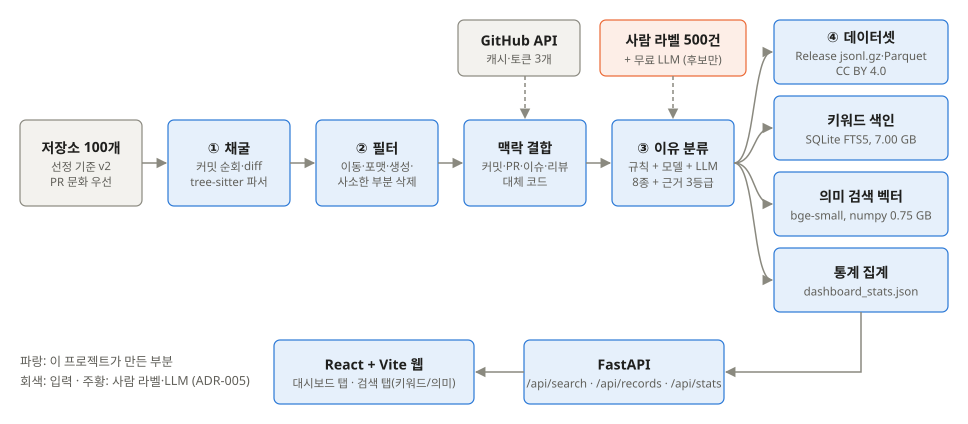
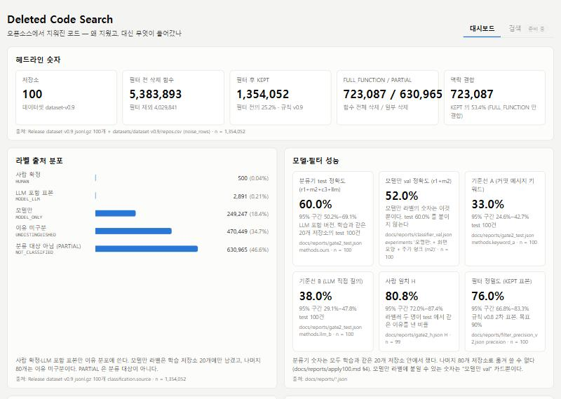
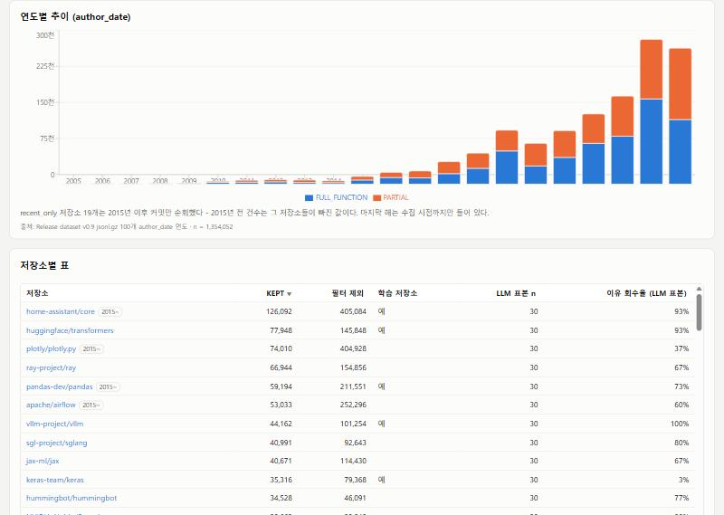
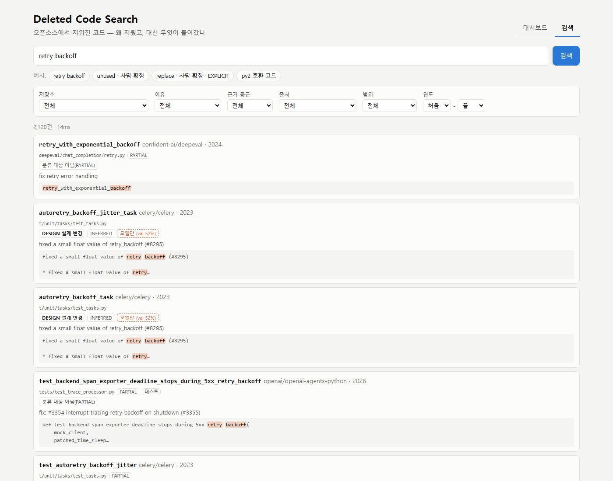
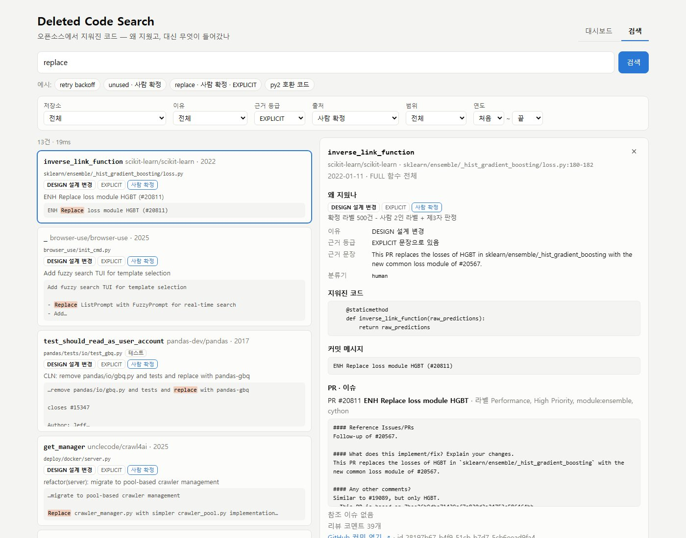
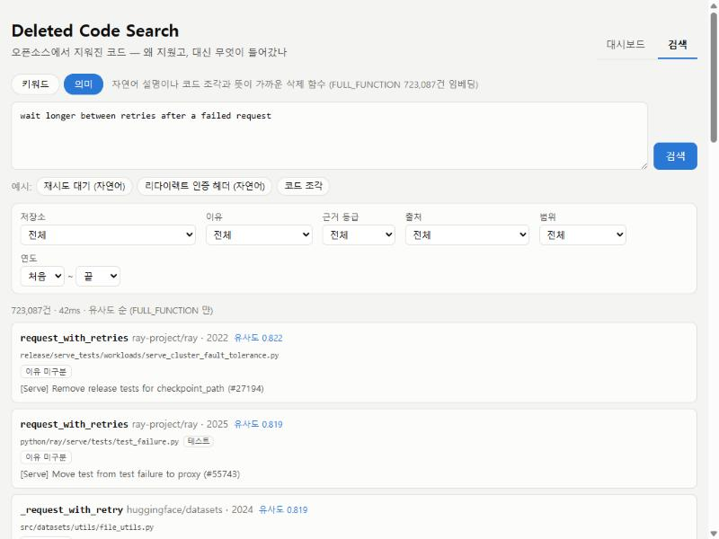
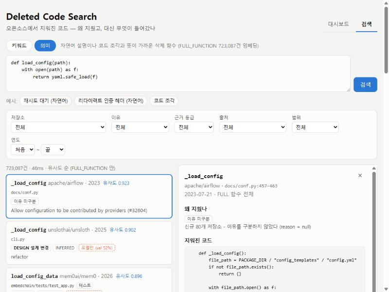
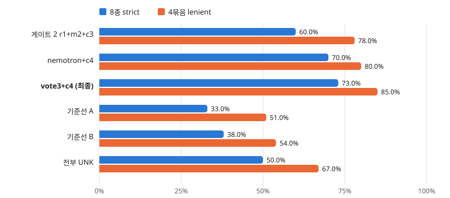

# 지워진 코드 검색엔진

**Deleted Code Search — 결과보고서**

캡스톤 페스티벌 2026 제출 작품

| 항목 | 내용 |
|---|---|
| 팀 | 깻잎 |
| 팀원 | 홍성제 32225001 (조장) / 재헌 {이름·학번} / 희수 {이름·학번} |
| 소속 | 단국대학교 소프트웨어학과 캡스톤디자인 |
| 제출 | 2026.11 |
| 저장소 | [github.com/Deleted-Code-Search/Deleted-Code-Search](https://github.com/Deleted-Code-Search/Deleted-Code-Search) |

<!-- cover-end -->

## 목차

- [요약](#요약)
- [1. 배경과 문제 정의](#1-배경과-문제-정의)
- [2. 목표와 범위](#2-목표와-범위)
- [3. 시장성과 수익모델](#3-시장성과-수익모델)
- [4. 사업화 계획과 실현 가능성](#4-사업화-계획과-실현-가능성)
- [5. 시스템 설계](#5-시스템-설계)
- [6. 구현](#6-구현)
- [7. 평가](#7-평가)
- [8. 개발 과정](#8-개발-과정)
- [9. 한계와 향후 계획](#9-한계와-향후-계획)
- [10. 팀 구성과 역할](#10-팀-구성과-역할)
- [부록. 문서와 코드 링크](#부록-문서와-코드-링크)

**이 보고서의 숫자.** 모든 숫자는 저장소의 측정 보고서와 데이터셋 요약에서 그대로 옮겼다. 이슈·PR·커밋 수만 이 보고서를 쓰며 `gh`와 `git`으로 새로 셌다 (2026-11-05 기준, §8.4). 원본은 [부록](#부록-문서와-코드-링크)에 있다.

**이 보고서의 태도.** 목표에 못 미친 수치와 버린 시도를 함께 적는다. 이 프로젝트의 주제가 "왜 지웠는지를 남기는 것"이기 때문이다.

## 요약

**문제.** 코드 검색과 AI 코딩 도구는 살아남은 코드만 본다. "이렇게 해 봤는데 이래서 버렸다"는 지식은 커밋·PR·이슈에 흩어져 묻혀 있다. 성공은 검색되는데 실패는 삭제된다. 저장소 하나에서도 이 지식을 손으로 찾기는 비현실적이다.

**해결.** 오픈소스 Python 저장소 100개의 이력에서 지워진 함수를 뽑아, **왜 지워졌는지**(이유 8종 + 근거 3등급)와 **대신 무엇이 들어왔는지**(대체 코드)를 묶었다. 결과물은 공개 데이터셋, 통계 대시보드, 키워드·의미 검색이다. 서버와 GPU 없이 노트북 3대와 무료 API로 끝까지 돌렸다.

**핵심 숫자**

| 항목 | 결과 |
|---|---|
| 저장소 | **100개**, 실행 실패 0 |
| 삭제 함수 → 의미 있는 삭제 | 5,383,893 (**538만**) → 1,354,052 (**135만**) |
| 이유 분류 | 8종 **73.0%** / 4묶음 **85.0%** (게이트 2 사전 등록 측정은 60.0%) |
| 의미 검색 P@10 | **0.625** (키워드 기준선 0.325), MRR 0.830 |
| 의미 검색 응답 시간 | p50 **46ms** · p95 **50ms** (목표 1초 이내) |
| 공개 데이터셋 | Release `dataset-v0.9`, 사람 확정 라벨 500건 포함, CC BY 4.0 |

**이 숫자를 읽을 때 알아야 할 것**

- **게이트 2는 미달이다.** 사전 등록한 test 1회 측정은 60.0%로 기준 80.0%에 못 미쳤고, 이 판정은 바뀌지 않는다. 73.0%·85.0%는 같은 test 100건을 보며 설정을 고른 값이라 새 데이터에서는 더 낮을 것으로 봐야 한다. 데이터셋 라벨에는 개선 분류기를 적용하지 않았다.
- **필터 정밀도는 76.0%로 목표 90%에 못 미친다** (규칙 v0.8 기준, v0.9는 새 표본으로 재측정하지 않았다). 135만 건 안에 의미 없는 삭제도 섞여 있다.
- **P@10은 질의 10개, 판정자 2명의 평균이다.** 계획한 질의 30개와 정규식 기준선은 측정하지 않았고, 팀 밖 사용자 평가도 하지 않았다.

**시장성과 사업화 (3·4장).** 시니어 리뷰어가 없는 개발자, AI 코딩 도구로 짠 코드를 검증하려는 기업, 연구자를 대상으로 플러그인 구독·B2B 분석·유료 API·데이터셋 상용판을 수익모델로 제시한다. 지금 단계(파이썬 100개 MVP)는 실측으로 끝났고, 다음 단계는 분류기 재측정과 사용자 검증이 먼저다.

## 1. 배경과 문제 정의

### 1.1 문제

개발 지식의 절반은 "무엇을 하지 말아야 하나"인데, 그 지식은 어디에도 저장되지 않는다 ([CHARTER §2.1](../../CHARTER.md#21-문제)).

- **스택오버플로**는 "어떻게"에 답한다. "해 봤는데 안 됐다"는 답하지 않는다.
- **코드 검색**(GitHub, Sourcegraph)은 현재 상태를 색인한다. 지워진 코드는 기본 검색 대상이 아니다.
- **AI 코딩 도구**는 살아남은 코드로 학습했다. 그럴싸하지만 나중에 지워질 코드를 뱉을 수 있다.
- **삭제 이유**는 커밋 메시지·PR·리뷰에 흩어져 있고, 저장소 하나에서도 손으로 찾기 비현실적이다.

비유하면 이렇다. 깃허브가 "살아있는 코드의 도서관"이라면, 이 프로젝트는 "실패한 코드의 부검 기록"이다. 의사가 사망 원인 통계로 배우듯, 개발자가 삭제 원인으로 배운다.

### 1.2 왜 어려운가

단순한 `git log` 검색으로 풀리지 않는 이유가 넷 있다. 이 넷이 곧 이 프로젝트의 기술 과제다.

| 어려움 | 내용 | 다룬 곳 |
|---|---|---|
| 삭제의 단위 | diff는 줄 단위다. "함수가 지워졌다"는 AST로 경계를 찾아야 안다 | §6.1 파이프라인 |
| 삭제의 대부분은 노이즈 | 이동·리네임·포맷 변경·생성 코드. 실제로 538만 건 중 135만 건만 남았다 | §6.2 필터 |
| 이유는 코드 밖에 있다 | 커밋 메시지·PR 본문·이슈·리뷰 코멘트를 결합해야 하고, 아예 안 적힌 경우도 많다 | §6.3 맥락 결합 |
| 정답이 흔들린다 | 사람끼리도 삭제 이유가 갈린다. 라벨 kappa 평균이 0.499였다 | §7.2 라벨 신뢰도 |

### 1.3 우리 답

오픈소스 저장소 100개의 삭제 이력을 **함수 단위**로 추출하고, **삭제 이유**와 **대체 코드**를 묶어 검색 가능하게 만든다. 이유를 100% 회수하는 일은 불가능하므로, 모든 레코드에 **근거 등급**을 달아 "모른다"를 숨기지 않는다 (ADR-004).

발표용 차별화 한 줄은 다음과 같다.

> 기존 도구는 내 코드베이스의 죽은 코드를 청소합니다. 기존 검색은 지워진 문자열을 찾습니다. 우리는 오픈소스 전체에서 남들이 왜 지웠는지를 배웁니다.

### 1.4 데이터의 원천과 적용 대상

이 구분이 프로젝트 성립의 전제다 ([CHARTER §2.6](../../CHARTER.md#26-데이터의-원천과-적용-대상-중요한-구분)).

- **원천(배우는 곳):** PR·이슈 문화가 강한 대형 오픈소스. 여기에만 이유가 기록되어 있다. 그래서 저장소를 별 수가 아니라 PR 문화 기준으로 골랐다 (ADR-006).
- **적용 대상(쓰는 곳):** 개인 저장소, 팀플, 프리랜서 협업. 여기엔 이유가 없지만 오픈소스가 대신 이유를 준다. 개인 저장소를 원천으로 쓰면 프로젝트가 성립하지 않는다.

### 1.5 주제 선정 경위

약 50개 후보를 검토했다. 참신함이 최우선이고, 어려움이 진짜여야 하며, 실패해도 붕괴가 아니라 축소로 끝나고, 선행 사례를 확인한다는 원칙으로 좁혔다 ([CHARTER §1.3](../../CHARTER.md#13-주제-선정-경위-요약)). 최종 후보 4개 중 팀 투표로 확정했다 (2026-09-08).

## 2. 목표와 범위

### 2.1 궁극 목표

소프트웨어 실패 지식의 검색 인프라. 모든 주요 언어·저장소를 색인하고, IDE에서 코드를 쓰는 순간 "이 패턴은 과거 N번 이런 이유로 삭제됨"을 알려주는 조기 경고 시스템이다. 이유가 기록된 오픈소스에서 삭제의 패턴을 배워, 이유가 기록되지 않은 모든 코드베이스에 그 이유를 되돌려준다.

### 2.2 교수님 피드백과 범위 조정

제안 단계의 피드백(2026-09-08)은 두 가지였다. "구현 범위가 너무 넓어 조금 줄이는 것이 좋겠다", "구현 시스템의 평가를 어떻게 할지 고민해 보라". 이 두 말을 다음과 같이 반영했다.

| 피드백 | 반영 | 근거 문서 |
|---|---|---|
| 범위를 줄여라 | 핵심 4개를 먼저 끝내고 확장은 그 뒤에만 착수한다 | ADR-008 |
| 범위를 줄여라 | 저장소 목표 500개 → **100개** | [ADR-020](../adr/020-repo-target-100.md) |
| 범위를 줄여라 | 함수 전체 삭제를 1차 대상으로. 부분 삭제는 5줄 이상만 데이터셋에 넣고 분류하지 않는다 | ADR-003, [ADR-015](../adr/015-partial-min-lines.md) |
| 평가를 고민하라 | 필터·분류·검색·사용자·시스템 5층 평가 계획을 세우고 기준을 측정 전에 등록했다 | [평가 계획](../evaluation.md) |

### 2.3 핵심 4 + 확장

| 구분 | 항목 | 상태 | 결과 |
|---|---|---|---|
| 핵심 ① | 삭제 코드 채굴 파이프라인 | 완료 | 저장소 100개, 삭제 함수 5,383,893건 |
| 핵심 ② | 의미 있는 삭제 필터 | 완료 — **정밀도 목표 미달** | 규칙 v0.9, KEPT 1,354,052건, 정밀도 76.0% (v0.8) |
| 핵심 ③ | 삭제 이유 분류 | 완료 — **게이트 2 미달** | test 60.0%, 이후 개선 8종 73.0% / 4묶음 85.0% |
| 핵심 ④ | 공개 데이터셋 | 완료 | Release `dataset-v0.9`, 확정 라벨 500건 |
| 확장 | 통계 대시보드 | 완료 | 패널 8개 |
| 확장 ⑤ | 키워드 검색 + 웹 UI | 완료 | SQLite FTS5, p50 28ms · p95 388ms |
| 확장 ⑤ | 의미 검색 | 완료 | P@10 0.625, p50 46ms · p95 50ms |
| 확장 ⑥ | 코드 진단 API | 착수 안 함 | 향후 (4장 3단계) |
| 확장 ⑦ | 개인 저장소 이유 추정 모델 | 착수 안 함 | 향후 |
| 확장 ⑧ | VS Code 플러그인 | 착수 안 함 | 향후 (4장 3단계) |

"완료"는 구현·실행·산출물이 나왔다는 뜻이다. 목표에 못 미친 수치는 함께 적었다.

### 2.4 처음 목표와 결과

| 목표 ([CHARTER §3.2](../../CHARTER.md#32-11월-mvp-반드시-완성)·§10) | 값 | 결과 | 달성 |
|---|---:|---:|---|
| 대상 저장소 | 100개 | 100개 | 달성 |
| 의미 있는 삭제 | 5만 건 이상 | 1,354,052건 | 달성 |
| 필터 정밀도 | ≥ 90% | 76.0% | **미달** |
| 필터 판정자 일치도 kappa | ≥ 0.7 | 0.763 | 달성 |
| 분류 정확도 (게이트 2) | ≥ 80.0% 그리고 ≥ 48.0% | 60.0% | **미달** (② 충족, ① 미충족) |
| 검색 P@10 | ≥ 0.6, 질의 30개 | 0.625, 질의 10개 | **부분 충족** |
| 검색 응답 시간 | ≤ 1초 | p95 50ms (의미), 388ms (키워드) | 달성 |
| 사용자 평가 | 사례 5건 | 하지 않음 | **미실시** |
| 데이터셋·코드 공개 | 라이선스 명시 | MIT / CC BY 4.0 | 달성 |

### 2.5 하지 않기로 한 것

실시간 저장소 모니터링, Python 외 언어의 완전 지원, "왜 버그였나" 같은 세부 원인 추론, 클라우드 배포·운영은 범위 밖으로 정했다 ([CHARTER §3.4](../../CHARTER.md#34-범위-밖-하지-않는-것)).

## 3. 시장성과 수익모델

이 장의 사업 내용은 **계획**이다. 고객 인터뷰와 시장 규모 조사는 하지 않았으므로 시장 규모 숫자를 적지 않는다. 가격도 아직 정하지 않았다. 사실로 적은 것은 선행 조사(2026-09-07)와 이 프로젝트의 측정값이다.

### 3.1 타깃 고객

| 고객 | 지금 겪는 문제 | 우리가 주는 것 | 첫 접점 |
|---|---|---|---|
| **시니어 리뷰어 없는 개발자·소규모 팀·학생** | 내 코드가 나중에 지워질 패턴인지 물어볼 사람이 없다. 우리 팀이 정확히 여기 해당한다 | 검색: 비슷한 코드를 남들이 왜 지웠는지 | 무료 웹 검색 → VS Code 플러그인 |
| **AI 코딩 도구로 짠 코드를 검증하려는 기업** | AI 도구는 살아남은 코드로 학습해, 그럴싸하지만 나중에 지워질 코드를 낼 수 있다. 리뷰 부담이 늘어난다 | 진단: AI가 낸 코드와 유사한 삭제 이력과 이유 분포 | 검색·진단 API → 사내 저장소 분석 |
| **연구자 (MSR, 소프트웨어 공학)** | 삭제 이유 연구마다 데이터를 새로 모으고 라벨한다 | 함수 단위 삭제 + 이유 + 대체 코드 데이터셋, 사람 확정 라벨 500건 | CC BY 4.0 공개 데이터셋 |

사용 장면은 다음과 같다 ([CHARTER §2.5](../../CHARTER.md#25-사용자와-사용-장면)).

1. 재시도 로직을 직접 짜려는 개발자가 `retry backoff`를 검색한다. 같은 방식을 썼다가 지운 프로젝트들의 코드와 이유, 대체 코드를 확인한다. **(지금 된다)**
2. 연구자가 파이썬 프로젝트의 삭제 이유 분포 데이터를 논문에 쓴다. **(지금 된다)**
3. PR을 올리기 전에 코드를 붙여 넣어 유사 삭제 이력과 이유 분포를 본다. **(진단 API, 향후. 코드 붙여넣기 의미 검색까지는 지금 된다)**
4. AI가 뽑아 준 코드가 나중에 왜 지워지는 패턴인지 확인한다. **(같은 기능, 향후)**
5. 커밋 메시지가 부실한 개인 저장소의 삭제 이유를 추정한다. **(확장 ⑦, 향후)**

### 3.2 경쟁과 차별점

선행 조사 결과(2026-09-07, [CHARTER §2.3](../../CHARTER.md#23-기존-것들과의-차이-선행-조사-결과-2026-09-07))를 비교 축으로 다시 정리했다.

| | 지워진 코드 찾기 | 함수 단위 | 삭제 이유 | 대체 코드 | 의미 검색 | 여러 저장소 | 도구로 사용 |
|---|---|---|---|---|---|---|---|
| **Sourcegraph diff 검색** | 예 (정규식) | 아니오 | 아니오 | 아니오 | 아니오 | 예 | 예 |
| **fossil-code** | 예 | 죽은 코드 탐지 | 설명 있음 | 아니오 | 아니오 | **아니오 (내 저장소 1개)** | 예 (CLI) |
| **deadcode-archaeologist** | 예 | fossil-code와 같은 계열 | 설명 있음 | 아니오 | 아니오 | **아니오** | 예 (CLI) |
| **MSR 학술 연구** | 연구마다 다름 | 연구마다 다름 | 통계 | 아니오 | 아니오 | 예 | **아니오 (논문)** |
| **Software Heritage** | 아카이브 | 아니오 | 아니오 | 아니오 | 아니오 | 예 | 아카이브 |
| **우리** | **예** | **예** | **8종 + 근거 등급** | **예** | **예** | **예 (100개)** | **예 (웹·데이터셋)** |

- **목적이 다르다.** fossil-code 계열은 **내 저장소 청소** 도구다. 우리는 **남의 저장소 100개에서 배우는** 검색엔진이다.
- **"모른다"를 표시한다.** 모든 결과에 근거 등급과 라벨 출처(사람 확정 / 분류기 버전)를 붙인다. 정확도가 낮은 라벨은 낮다고 화면에 함께 보여 준다.
- **선점한 자산은 데이터다.** 선행 조사에서 "삭제 함수 + 이유 + 대체 코드" 데이터셋과 크로스 저장소 삭제 코드 의미 검색을 찾지 못했다. 사람 확정 라벨 500건과 함께 공개한 것이 그 기록이다.

**솔직한 약점.** 기능 격차는 영구적이지 않다. Sourcegraph 같은 기존 사업자가 diff 검색 위에 LLM 요약을 얹으면 표의 "삭제 이유" 칸이 일부 좁혀진다. 진입 장벽이 되는 것은 기능이 아니라 **라벨 데이터와 평가 절차**다. 또 위 표는 2026-09-07 조사 기준이므로 제출 전에 다시 확인할 필요가 있다.

### 3.3 수익모델

공개 데이터셋과 기본 검색은 무료로 두어 사용자를 모으고, 작업 흐름 안에 들어가는 기능과 사내 데이터 처리에 과금한다.

| 수익원 | 무엇을 파나 | 고객 | 과금 단위 | 필요한 선행 조건 |
|---|---|---|---|---|
| **VS Code 플러그인 구독** | 코드를 쓰는 순간 유사 삭제 이력과 이유 분포 경고 | 개인 개발자, 소규모 팀 | 사용자당 월 구독 | 진단 API, 플러그인 (확장 ⑥⑧) |
| **기업 사내 저장소 분석 (B2B SaaS)** | 사내 저장소의 삭제 이력·이유 통계, 사내 규칙 검색. 코드가 밖으로 나가지 않는 설치형 포함 | AI 코딩 도구를 도입한 기업 | 조직·저장소 규모별 계약 | 사내 저장소용 파이프라인 패키징, 보안 검토 |
| **검색·진단 API 유료 호출** | 다른 도구(코드 리뷰 봇, AI 코딩 도구)가 부르는 삭제 이력 조회 | 개발 도구 회사, 기업 | 호출 수 | 호스팅 서버, API 안정화 |
| **데이터셋 상업 라이선스** | 공개판에 없는 것: 개선 분류기 라벨, 정기 갱신, 추가 언어, 납품 형식과 지원 | AI·개발 도구 회사 | 판본·연 단위 계약 | 분류기 재측정, 유료 LLM 비용 |

**데이터셋 라이선스를 구분하는 법.** 공개판은 CC BY 4.0이라 출처를 밝히면 상업적으로도 쓸 수 있다. 그러므로 유료판이 파는 것은 "사용 권리"가 아니라 **공개판에 없는 품질과 갱신**이다. 또한 행에 들어 있는 코드 스니펫은 원 저장소 라이선스를 따르므로(ADR-011) 유료판이라도 다시 라이선스할 수 없다.

| | 공개판 (지금) | 상용판 (계획) |
|---|---|---|
| 라이선스 | CC BY 4.0, 스니펫은 원 라이선스 | 별도 계약, 스니펫은 원 라이선스 그대로 |
| 사람 확정 라벨 | 500건 | 추가 라벨 |
| 분류기 라벨 | 기존 분류기(`r1+m2`, `r1+m2+c3` 표본), 신규 80개는 이유 미구분 | 재측정을 통과한 분류기로 전체 적용 |
| 갱신 | `dataset-v0.9` 1회 | 정기 |
| 범위 | Python 100개 | 다국어, 저장소 확대 |

### 3.4 수익화 순서와 가장 약한 근거

순서는 무료 → 개인 → API → 기업이다. 무료 공개 자산으로 신뢰를 쌓아야 기업 영업의 근거가 생긴다. **가장 약한 고리는 지불 의사와 효용을 잰 적이 없다는 점이다.** 개발자 10명 사용 평가(CHARTER §10.4)를 하지 않았으므로, 2단계에 들어가기 전에 이것부터 잰다.

## 4. 사업화 계획과 실현 가능성


*그림 4-1. 사업화 4단계. 기간은 정하지 않았고, 단계마다 넘어가는 조건을 둔다.*

### 4.1 단계별 계획

| 단계 | 내용 | 필요한 것 | 위험 | 근거 |
|---|---|---|---|---|
| **1단계 MVP** (완료) | 파이썬 저장소 100개, 데이터셋·대시보드·검색 | 노트북 3대, 무료 API, 팀 3명 | 정확도·정밀도 목표 미달 | 실행 실패 0/100, 숫자는 7장 |
| **2단계 확대** | 두 번째 언어 어댑터(JS/TS), 저장소 확대 | 언어별 사람 라벨, 유료 LLM 또는 서버 | 분류기가 학습 저장소 밖으로 일반화되지 않는다 | 파서 인터페이스 분리(ADR-002), 20 → 100 확대 실측 |
| **3단계 IDE** | 진단 API, VS Code 플러그인 | 호스팅 서버, 플러그인 개발 | 낮은 정밀도의 경고는 개발자가 끈다 | 응답 p50 46ms, 코드 조각 질의 동작 |
| **4단계 기업용** | 사내 저장소 분석, API 유료화 | 설치형 패키징, 보안 검토, 첫 고객 | 사내 저장소는 이유 기록이 적을 수 있다 | 외부 서버 없이 노트북에서 도는 구조 |

### 4.2 단계를 넘어가는 조건

기존에 정한 목표를 그대로 쓴다. 새 기준을 만들지 않았다.

| 넘어가는 곳 | 조건 | 지금 상태 |
|---|---|---|
| 1 → 2 | 새 표본에서 분류기 재측정 (사전 등록의 "새 표본에서만") | 하지 않음 |
| 1 → 2 | 필터 정밀도 v0.9 새 표본 재측정, 목표 ≥ 90% | 76.0% (v0.8), 재측정 안 함 |
| 1 → 2 | 개발자 10명 사용 평가, 유용한 발견 사례 5건 이상 (CHARTER §10.4) | 하지 않음 |
| 2 → 3 | 검색 평가 질의 30개·정규식 기준선 대비, P@10 ≥ 0.6 (CHARTER §10.3) | 질의 10개 0.625, 정규식 미측정 |
| 3 → 4 | 진단 API·플러그인 사용 데이터로 경고가 유용한지 확인 | 착수 전 |

### 4.3 실현 가능성의 근거: 실측

이 프로젝트의 비용 구조는 추정이 아니라 실제로 돌려서 잰 값이다.

| 항목 | 실측 | 출처 |
|---|---:|---|
| 저장소 100개 파이프라인 합계 | 550,844.7초 (노트북 3대 분담) | [대시보드 집계](../reports/dashboard_stats.json) |
| 저장소당 중앙값 / 최대 | 2,537.3초 / 55,000.3초 (`home-assistant/core` 약 15시간) | 같은 곳, ADR-020 |
| 실패 저장소 | 0 / 100 | 같은 곳 |
| 분류기 100개 적용 (모델만) | 파일 4개 동시 실행, 가장 긴 것 약 34분 | [apply100](../reports/apply100.md) |
| 키워드 색인 | 4.0분, 7.00 GB | ADR-022 |
| 임베딩 723,087건 | 324.6분, 0.75 GB, CPU | [모델 선택](../reports/embedding_model_choice.md) |
| 의미 검색 응답 | p50 46ms · p95 50ms, 서버 시작 때 읽기 1.3초 | [응답 시간](../reports/search_latency_semantic.md) |
| 현금 비용 | **0원** (NVIDIA 무료 API, 팀원 노트북, GitHub 토큰) | [CHARTER §7, §17](../../CHARTER.md#7-기술-스택과-환경) |

이 값이 뜻하는 것은 세 가지다.

- **서버 없이 MVP가 끝났다.** GPU도 학교 서버도 없이 노트북 3대에 저장소를 나눠 돌렸다. 실패한 저장소는 없었다.
- **서빙 비용이 작다.** 72만 건 전수 내적이 50ms 안에 끝나므로 벡터 DB가 필요 없다 (ADR-023). 검색 서비스는 작은 서버 한 대에서 시작할 수 있다는 근거다.
- **규모를 키우면 무료로는 안 되는 부분을 안다.** 개선 분류기 `vote3+c4`는 건당 5회 호출이라 FULL_FUNCTION 723,087건에 약 360만 회가 필요하다. 무료 API로는 돌릴 수 없고, 무료 한도(429)는 test 100건을 돌릴 때도 이미 나타났다. 2단계의 첫 비용 항목이 여기다. 금액은 공급자를 정한 뒤에 산정한다.

### 4.4 단계별 위험과 대응

| 위험 | 측정된 근거 | 대응 |
|---|---|---|
| 분류기 일반화 실패 | 신규 80개에서 LLM 포함이 다른 이유를 낸 606건 중 모델만 일치 0건 | 저장소 확대 전에 LLM 포함 분류기를 표본에서 재측정. 일치하지 않는 라벨은 지금처럼 "이유 미구분"으로 표시 |
| 라벨 일치도 | `reason` kappa 평균 0.499, `grade` 0.404 | 다국어 라벨을 늘리기 전에 가이드·체크리스트 재검토 |
| 필터 정밀도 | 76.0%, 표본 안 규칙 후보를 다 고쳐도 84 | 경로·포맷 규칙 외에 제자리 재작성 탐지. 규칙을 바꾸면 새 표본 재측정 |
| 라이선스 | 저장소는 permissive여도 34,391행은 다른 라이선스 가능성으로 `LINK_ONLY` | 행 단위 규칙 유지, 저장소 추가 때 원문 재확인. 상용화 전 법률 검토 |
| 경쟁 | §3.2 | 라벨 데이터와 평가 절차를 자산으로 공개·축적 |
| 사용자 효용 미검증 | CHARTER §10.4 미실시 | 2단계 진입 조건으로 둔다 |

## 5. 시스템 설계

### 5.1 전체 구조



*그림 5-1. 시스템 구조. 데이터는 왼쪽에서 오른쪽으로 한 번 흐르고, 서빙은 만들어진 파일만 읽는다.*

| 구성 요소 | 코드 | 입력 → 출력 | 담당 |
|---|---|---|---|
| 저장소 선정 | `pipeline/select_repos.py` | GitHub API → 저장소 목록 CSV | 성제 |
| 채굴 | `pipeline/clone.py`, `walk.py`, `extract.py`, `run.py` | 클론 → 삭제 함수 JSONL | 재헌 |
| 파서 | `pipeline/parsers/` | 소스 텍스트 → 함수 목록 | 재헌 |
| 필터 | `pipeline/filter.py`, `postfilter.py` | 삭제 함수 → `filter_status` | 재헌, 성제 |
| 맥락 결합 | `pipeline/context.py` | 커밋 → PR·이슈·리뷰·대체 코드 | 희수 |
| 조립·내보내기 | `pipeline/assemble.py`, `export.py` | → Release Parquet·jsonl.gz | 재헌 |
| 이유 분류 | `classify/` | 레코드 → 이유·근거 등급 | 희수 |
| 평가 | `eval/` | 예측·라벨 → 보고서 | 성제, 희수 |
| 검색·통계 | `search/` | jsonl.gz → SQLite·numpy·JSON, API | 성제, 희수 |
| 화면 | `web/` | API → 대시보드·검색 | 성제 |
| 라벨링 도구 | `tools/` | 표본 → 사람 라벨 | 성제 |

**설계 원칙 셋.** 언어 독립(파서 계층 분리), 단계마다 파일로 끊기(실패 복구와 3인 분담), 서빙은 읽기 전용(무거운 계산은 한 번만).

### 5.2 데이터 스키마 요약

레코드 하나가 삭제 하나다 ([CHARTER §4.4](../../CHARTER.md#44-데이터-스키마-v1)). 전체 필드는 [데이터셋 문서](../../datasets/dataset-v0.9/README.md)에 있다.

| 묶음 | 주요 필드 | 뜻 |
|---|---|---|
| 출처 | `repo`, `repo_license`, `commit_sha`, `parent_sha`, `author_date`, `file_path`, `source_url` | 어디서 언제 지워졌나 |
| 지워진 코드 | `function_name`, `function_signature`, `deleted_body`, `deletion_kind`, `is_test_code` | 무엇이 지워졌나 |
| 필터 | `filter_status`, `filter_rule_version` | 의미 있는 삭제인가 |
| 맥락 | `context.commit_message`, `pr_*`, `issue_*`, `review_comments[]` | 이유가 적혔을 곳 |
| 대체 코드 | `replacement.code`, `match_method`, `confidence` | 대신 무엇이 들어왔나 |
| 이유 | `reason.label`, `evidence_grade`, `evidence_text`, `confidence`, `classifier_version` | 왜 지웠나, 근거는 얼마나 강한가 |
| 공개 속성 | `code_policy`, `classification.source`, `training_repo`, `split` | 코드 포함 여부, 사람 라벨인가 분류기인가 |

**이유 8종과 근거 3등급** ([CHARTER §4.2 ③](../../CHARTER.md#42-구성요소별-상세))

| 코드 | 이유 | 정의 | 코드 | 이유 | 정의 |
|---|---|---|---|---|---|
| BUG | 버그 수정 | 잘못된 동작을 고치려 제거 | DEAD | 죽은 코드 | 호출되지 않아 제거 |
| PERF | 성능 | 느리거나 자원을 많이 써 교체 | DESIGN | 설계 변경 | 구조·추상화 변경으로 제거 |
| SEC | 보안 | 취약점·위험한 패턴 제거 | FEAT | 기능 제거 | 기능 자체를 없앰 (폐기, 지원 종료) |
| LIB | 라이브러리 교체 | 직접 구현을 라이브러리로 대체 | UNK | 불명 | 어느 것으로도 판단 불가 |

| 등급 | 뜻 | 저장하는 것 |
|---|---|---|
| `EXPLICIT` | PR·이슈·커밋에 이유가 문장으로 있음 | 원문 인용 |
| `INFERRED` | 닫힌 목록 6종의 구조적 신호로 추론 (대체 코드, 호출자 변화, 테스트 변화, 공개 표면 변화, 같은 커밋의 동형 삭제, 삭제된 코드 자체) | 추론 근거, 신뢰도 (ADR-012, ADR-017) |
| `UNKNOWN` | 판단 불가 | 원인 태그 |

"커밋이 큰 작업 X를 하고 이 함수가 X 영역에 있다" 같은 주제적 근접성은 근거가 아니다. 주관적 짐작을 막기 위해 목록을 닫아 두었다 (ADR-017).

### 5.3 주요 설계 결정 (ADR)

전체는 [CHARTER §5](../../CHARTER.md#5-핵심-설계-결정-adr-요약)와 [docs/adr/](../adr/README.md)에 있다. 대안과 버린 이유까지 기록했다.

| ADR | 결정 | 왜 | 버린 대안 |
|---|---|---|---|
| 002 | 파서 계층을 인터페이스로 분리 | 최종 목표가 다국어. 확장 비용을 어댑터 하나로 | Python 전용 하드코딩 |
| 003 | 함수 전체 삭제를 1차 대상으로 | 경계가 명확해 필터·매칭이 정확 | 라인 단위, 파일 단위 |
| 004 | 이유 8종 + 근거 3등급 | 100% 회수가 불가능하니 정직한 표시가 필수 | 이유만 표시 |
| 005 | LLM은 후보 생성·근거 작성에만 | LLM 출력을 정답으로 쓰면 평가가 무의미 | LLM 단독 분류 (기준선 B로만) |
| 006 | 저장소는 PR 문화 기준으로 선정 | 별 수와 이유 회수율은 무관 | 별 수 상위 N |
| 008 | 핵심 4 → 확장 순차 | 교수님 피드백. 조각 8개 동시 진행은 실패 패턴 | 전체 병렬 |
| 011 | 코드 MIT / 데이터셋 CC BY 4.0 / 스니펫 원 라이선스 | 재사용을 넓히되 저작자 표시 유지 | 전부 MIT, CC0 |
| [012](../adr/012-inferred-confidence-bands.md) | INFERRED 신뢰도 경계 0.5 / 0.8을 측정 전 확정 | 라벨링 후에 바꾸면 결과에 맞췄다는 반론을 막을 수 없다 | 분포를 보고 사후 결정 |
| [014](../adr/014-move-detection-rules.md) | 이동 탐지: AST 정규화 + 유사도 ≥ 0.9 | 치환이 적을수록 이동과 다른 함수를 구분 | 토큰 기반 유사도 |
| [016](../adr/016-gate2-accuracy-criteria.md) | 게이트 2 기준 min(80%, H) + 기준선 +10%p | 사람끼리도 갈리는 라벨에 절대 80%만 두면 라벨 일치도를 재게 된다 | 절대 80% 유지 |
| [017](../adr/017-inferred-evidence-kinds.md) | INFERRED 근거를 닫힌 목록 6종으로 | 해석이 갈려 kappa 0.261이 나왔다 | 근거 3종 유지, INFERRED 폐지 |
| [019](../adr/019-third-party-adjudication.md) | 라벨 불일치는 제3자 판정 | 불일치 69/150건 규모를 토론으로 확정하면 쌍마다 방식이 달라진다 | 토론, 3인 다수결, 갈린 건 제외 |
| [020](../adr/020-repo-target-100.md) | 저장소 500 → 100 | 20개만으로 건수 목표를 넘었고, 실측 비용으로 500개는 끝낼 근거가 없다 | 500 유지, 20에서 멈춤 |
| [021](../adr/021-pxa-chain-rule.md) | P × A를 연쇄 법칙으로 정식화 | 독립 가정을 없앤다 | P × A 그대로 |
| [022](../adr/022-keyword-search-sqlite-fts5.md) | 키워드 검색은 SQLite FTS5 | Docker·네이티브 DLL 없이 135만 건을 충분히 처리 | PostgreSQL, Elasticsearch |
| [023](../adr/023-semantic-search-numpy-bge-small.md) | `bge-small-en-v1.5` + numpy 파일 | 72만 × 384 전수 내적 0.035초라 인덱스·DB가 필요 없다 | pgvector, FAISS, 더 큰 임베딩 모델 |

### 5.4 기술 스택

| 영역 | 선택 |
|---|---|
| 언어 | Python 3.12 (파이프라인·분류·API), TypeScript (웹) |
| 파싱 | tree-sitter + tree-sitter-python |
| 분류 | scikit-learn (TF-IDF + 로지스틱 회귀) + LLM (NVIDIA 무료 API) |
| 검색 | SQLite FTS5 (키워드), fastembed + ONNX Runtime + numpy (의미) |
| API·웹 | FastAPI, React + Vite, recharts |
| 데이터 | JSONL·Parquet, GitHub Release |
| 품질 | pytest, ruff, GitHub Actions |

**계획에서 바뀐 것.** 처음에는 PostgreSQL + pgvector가 저장소였다 (ADR-009). 개발 노트북에 Docker가 없고 스마트 앱 컨트롤이 네이티브 DLL을 막는 현실적 제약과, 규모 실측 결과를 근거로 ADR-022·023이 이를 대체했다. torch도 같은 이유로 쓰지 않는다.

## 6. 구현

### 6.1 채굴 파이프라인

저장소를 전체 이력으로 클론하고, 기본 브랜치의 커밋을 시간순으로 돌며 부모 대비 diff에서 삭제 헝크를 뽑는다. 병합 커밋은 건너뛰어 중복을 막는다. 삭제 헝크가 tree-sitter로 찾은 함수 경계를 모두 덮으면 `FULL_FUNCTION`, 일부만 덮으면 `PARTIAL`이다.

- **파서 인터페이스.** `extract_functions(source_text) -> [Function(...)]`. 언어를 추가할 때 어댑터 하나만 구현한다 (`pipeline/parsers/base.py`).
- **병렬·복구.** 저장소 단위로 워커를 나누고 실패하면 재시도한다 (#81). 실행 기록의 상태·시간·실패 단계가 §7.7 시스템 성능의 입력이다.
- **3인 분담.** 저장소 목록을 3분할해 각자 노트북에서 돌리고 결과만 합쳤다. 조립 단계(`pipeline/assemble.py`, #101)가 중복·버전 불일치·실패 저장소를 검사한다.
- **큰 저장소.** 최초 커밋이 2015년 이전인 19개는 2015년 이후만 채굴했다 (`recent_only`). 저장소 고유 문제는 실행하며 고쳤다 (non-UTF-8 Git 출력 #144, log 구분자 충돌 #144, U+2028 줄 분리 #146).

### 6.2 의미 있는 삭제 필터

"배울 게 있는 삭제"만 남긴다. 추출 때 적용하는 규칙과, 조립 결과에 나중에 적용하는 사후 필터로 나뉜다 ([필터 규칙](../filter_rules.md)).

| 상태 | 규칙 | 건수 |
|---|---|---:|
| `NOISE_TRIVIAL` | 부분 삭제 중 4줄 이하 (ADR-015) | 2,855,071 |
| `NOISE_MOVE` | 같은 커밋의 다른 위치에 정규화 본문이 같거나 유사도 ≥ 0.9인 함수 (ADR-014) | 946,350 |
| `NOISE_GENERATED` | `site-packages`·벤더·venv·`*_pb2.py` 경로 (사후, #184) | 150,861 |
| `NOISE_FORMAT` | 포맷 커밋의 재포맷: 메시지에 포맷 키워드 + 삭제 줄 90% 이상이 재등장 (사후, #152) | 77,559 |
| **`KEPT`** | **의미 있는 삭제** | **1,354,052** |
| 합계 | 필터 전 삭제 함수 | 5,383,893 |

KEPT 구성은 FULL_FUNCTION 723,087건, PARTIAL(5줄 이상) 630,965건이다.

- **오탐보다 미탐.** 이동이 아닌데 이동으로 빼면 레코드가 영구히 사라지지만, 이동을 못 잡으면 노이즈가 남을 뿐 사람 단계에서 거를 수 있다. 그래서 애매하면 남긴다 (1:1 매칭, 실제 추가 줄과 겹치는 함수만 후보).
- **미구현.** `NOISE_RENAME`과 `NOISE_BULK`는 구현하지 않았고, `NOISE_FORMAT`·`NOISE_GENERATED`도 일부 범위만 구현했다.

### 6.3 맥락 결합과 대체 코드

삭제 이유는 코드가 아니라 텍스트에 적혀 있다. 함수 전체 삭제(FULL_FUNCTION 723,087건 모두)에 다음을 붙였다.

- **커밋 메시지 → PR → 이슈 → 리뷰 코멘트.** GitHub API(시간당 5,000회)로 조회하고 캐시한다. 팀원 3명의 토큰을 나눠 쓴다. 리뷰 코멘트는 근거를 다시 찾을 수 있게 `comment_id`·`side`와 함께 저장한다 (ADR-018).
- **대체 코드.** 같은 커밋·같은 파일의 추가 헝크에서 삭제 위치와 겹치는 것을 찾는다(`SAME_LOCATION`). 호출자 변경도 대체 신호다(`CALLER_CHANGE`). 존재한 적 없는 본문을 만들지 않으려고 헝크 단위로만 파싱한다 (§8.3).
- **비용을 줄이기.** 대상을 FULL_FUNCTION으로 좁혔고 (#142), 파싱 캐시·병렬화와 한도 시 파싱 지연을 넣은 뒤에야 100개로 확대했다 (#128).

### 6.4 이유 분류기

세 가지 방식을 비교하도록 처음부터 설계했다 (ADR-005). 정답은 사람 확정 라벨이고 LLM은 정답이 되지 못한다.

| 방식 | 버전 | 어떻게 |
|---|---|---|
| 기준선 A | `a1` | 커밋 메시지 키워드 규칙 |
| 기준선 B | `b1` | LLM 직접 질의 (diff + 메시지) |
| 우리 방식 | `r1+m2+c3` | 규칙 + 모델 + LLM 합산 |

우리 방식의 구조는 다음과 같다 ([분류기 학습·검증](../reports/classifier_val.md)).

1. **LLM 후보(프롬프트 c3).** 라벨러 화면과 같은 정보와 가이드 판정 순서 요약을 주고 라벨 후보를 받는다.
2. **모델 m2.** TF-IDF + 로지스틱 회귀, UNK를 포함한 8종. 맥락 문장·함수 이름·화면 모양 낱말을 특징으로 쓴다.
3. **점수 = 모델 확률 + 0.5 × [LLM이 고른 라벨].** 가장 높은 라벨을 고른다.
4. **규칙 r1은 라벨을 고르지 않는다.** 근거 등급과 원문 인용에만 쓴다. 규칙 키워드 표를 라벨 점수에 넣었더니 BUG를 98건(정답 6건) 내 교차 검증이 0.46 → 0.33으로 떨어졌기 때문이다.

**100개 적용.** 건당 호출 비용과 게이트 결과 때문에 전부 LLM으로 돌리지 않았다 (#180). 그 결과 라벨 출처가 다섯 갈래다. 이유 분포를 보고할 때는 사람 확정과 LLM 표본만 쓴다.

| 출처 | 행 | 이유 칸 | 성능으로 말하는 값 |
|---|---:|---|---|
| `HUMAN` | 500 | 사람 확정 | 정답 |
| `MODEL_LLM` | 2,891 | `r1+m2+c3` (저장소마다 표본) | test 60.0% |
| `MODEL_ONLY` | 249,247 | `r1+m2` (학습 저장소 20개) | val 52.0% |
| `UNDISTINGUISHED` | 470,449 | null, "이유 미구분" (신규 80개) | 없음. 구체적 이유를 믿지 않는다 |
| `NOT_CLASSIFIED` | 630,965 | null (PARTIAL은 분류 대상이 아니다) | 없음 |

신규 80개를 "이유 미구분"으로 낸 것은 숫자를 보기 전에 정한 기준을 따른 결과다 (§7.3).

### 6.5 데이터셋 공개

| 항목 | 값 |
|---|---|
| 배포 | [GitHub Release `dataset-v0.9`](https://github.com/Deleted-Code-Search/Deleted-Code-Search/releases/tag/dataset-v0.9) (2026-10-29) |
| 형식 | 저장소별 Parquet + 같은 행의 jsonl.gz |
| 규모 | 저장소 100개, 1,354,052행 |
| 사람 라벨 | 500건 (train 300 / val 100 / test 100), 저장소에도 [`main500.jsonl`](../../datasets/dataset-v0.9/main500.jsonl) |
| 라이선스 | 데이터셋 CC BY 4.0, 스니펫은 원 저장소 라이선스, 행마다 출처 링크 |
| 코드 포함 | `CODE_INCLUDED` 1,319,661행 / `LINK_ONLY` 34,391행 |

**라이선스를 행 단위로 다시 봤다.** 저장소 루트 라이선스는 100개 모두 permissive(Apache-2.0 51, MIT 39, BSD-3-Clause 9, BSD-2-Clause 1)다. 그러나 2026-10-29에 원문과 이력을 확인해 보니, 9개 저장소의 일부 경로·시기는 AGPL·GPL·MPL·독점 등 다른 라이선스 아래였거나 라이선스를 정할 수 없었다. 그 34,391행은 코드를 비우고 링크와 메타데이터만 낸다. 행을 빼지 않아 통계와 평가 집합은 그대로다.

### 6.6 웹: 대시보드와 검색

데이터 없이도 대시보드는 바로 뜨고, 검색은 색인이 있으면 켜진다. 모든 패널이 출처와 표본 수를 함께 적는다. `run.ps1` 하나로 실행한다 (부록).



*그림 6-1. 대시보드 위쪽. 헤드라인 숫자, 라벨 출처, 모델·필터 성능.*



*그림 6-2. 연도별 추이와 저장소별 표.*



*그림 6-3. 키워드 검색(`retry backoff` 등). 필터 6종(저장소·이유·근거 등급·출처·범위·연도)과 매칭 강조.*



*그림 6-4. 상세 패널. 지워진 코드·커밋·PR·이슈·대체 코드·이유·근거 문장·GitHub 링크를 한곳에서 본다.*



*그림 6-5. 의미 검색. 자연어로 찾으면 낱말이 겹치지 않아도 뜻이 가까운 함수가 나온다.*



*그림 6-6. 코드 조각 검색. 이유 미구분 배지처럼 라벨 출처와 신뢰 수준을 결과마다 표시한다.*

| 기능 | 구현 |
|---|---|
| 키워드 검색 | 함수 이름·경로·커밋 메시지·PR 제목·이슈 제목·지워진 코드를 FTS5로. BM25 정렬, 구문·접두어 |
| 의미 검색 | 질의를 같은 모델로 임베딩하고 FULL_FUNCTION 723,087건과 전수 내적. 서버 시작 때 벡터를 메모리에 읽는다 |
| 필터 | 같은 FTS 표의 `facets` 토큰 교집합 (키워드), 마스크 (의미) |
| 정직한 표시 | 출처 배지를 항상 단다. `LINK_ONLY`는 코드 대신 GitHub 링크. 분류기 라벨에는 성능 숫자를 함께 표시 |

## 7. 평가

교수님 피드백("평가를 어떻게 할지 고민")에 대한 답으로 계획을 세웠고, 주요 기준은 **측정 전에 문서로 등록**했다 ([평가 계획·사전 등록](../evaluation.md)). 미달도 그대로 보고한다.

### 7.1 필터 정밀도

필터 통과(KEPT) 100건 + 제외 100건을 3인이 독립 판정하고 다수결로 정했다 (#89).

| 차수 | 규칙 | 정밀도 (KEPT 100건) | Fleiss kappa | 재현율 (층 가중) | 결과 |
|---|---|---:|---:|---:|---|
| 1차 (2026-10-02) | v0.7 | 57.0% | 0.462 | 70.2% | 둘 다 미달 |
| 2차 (2026-10-06) | v0.8 | **76.0%** (Wilson 95% 66.8~83.3%) | **0.763** | 46.6% | 정밀도 미달, kappa 충족 |

목표는 정밀도 ≥ 90%, kappa ≥ 0.7이다. 1차와 2차는 표본·판정 기준·판정 화면·필터가 모두 달라 차이를 어느 하나 덕으로 돌릴 수 없다.

- **원인.** 1차 "아니오" 43건 중 가장 큰 단일 원인은 포맷 변경 17건이었다. 2차 "아니오" 24건은 재포맷, 제자리 재작성, 벤더·저장소 분리 등으로 나뉜다 ([1차 분석](../reports/filter_precision_analysis.md), [2차](../reports/filter_precision_v2.md)).
- **그 자리에서 규칙을 고치지 않았다.** 같은 표본으로 규칙을 고르고 같은 표본으로 세면 낙관적인 숫자가 나온다. 2차 분석의 규칙 후보가 모두 효과를 내도 최대 8건이라 84이고, 그것도 표본 안 숫자다.
- **v0.9.** `NOISE_GENERATED`를 더한 v0.9로 2차 표본을 재채점했더니 바뀐 표본은 0건이고 76.0% 그대로다 ([확인 기록](../reports/noise_generated_v0.9.md)). **새 표본 재측정은 하지 않았다.**
- **재현율 46.6%는 낮다.** 오탐보다 미탐을 택한 결과와 별개로, 제외 층 안에도 의미 있는 삭제가 있다는 뜻이다 (`NOISE_TRIVIAL` 표본 중 "예" 39.4%).

### 7.2 사람 라벨과 이유 회수율

라벨 500건은 저장소 20개에서 균등하게 뽑았고, 건마다 2인이 독립 라벨한 뒤 갈리면 제3자가 둘 중 하나를 골랐다. 2인 일치 350건 + 제3자 판정 150건이다 ([라벨 리포트](../reports/labels_main500.md)).

| 구간 | 회수 (분모 500) | 회수율 |
|---|---:|---:|
| EXPLICIT만 | 110 | **22.0%** |
| EXPLICIT + INFERRED(≥0.5) — 이유 회수율 정의 | 276 | **55.2%** |
| EXPLICIT + INFERRED(≥0.8) | 121 | **24.2%** |

이유 분포는 UNK 224 · DESIGN 148 · DEAD 69 · FEAT 33 · LIB 17 · BUG 8 · SEC 1 · PERF 0이다. 등급 분포는 EXPLICIT 110 / INFERRED 166 / UNKNOWN 224다.

**이 숫자의 약점을 함께 적는다.**

- **kappa가 낮다.** 사전 등록 최종(51번 이후 v3 쌍) 평균은 `reason` 0.499 / `grade` 0.404로 기준 0.6 아래이고, 0.6 이상은 블록 B `reason` 0.655 하나다. 사전 등록대로 대응 없이 수치만 보고했다.
- **회수율이 제3자 판정에 기댄다.** 판정 전(등급이 정해진 361건) 38.0%였고, 2인 일치 350건 중 36.0%, 제3자 판정 150건 중 100%다. 판정 150건은 저장 시각으로 5분 17초에 끝났고, 한 건도 UNKNOWN으로 가지 않았으며(등급이 강한 쪽 136/150), 판정 이유가 기록되지 않았다.
- **예비 200건과 같은 잣대로 비교하지 않는다.** 예비 200건(가이드 v1, 73.5%)은 저장소 1개이고, 500건은 가이드 v3로 기준이 엄격해진 뒤의 값이다. 게이트 1을 다시 판정하지 않는다.

### 7.3 이유 분류: 게이트 2

정답은 사람 확정 라벨이고, test 100건은 **한 번만** 돌렸다. 기준과 사람 일치율 H는 실행 전에 기록했다 ([판정 기록](../meetings/gate-2.md)).

| 방식 | 버전 | test 정확도 | 95% 구간 (Wilson) |
|---|---|---:|---|
| 모두 UNK 라고 답하기 | - | 50.0% | - |
| 기준선 A (커밋 메시지 키워드) | `a1` | 33.0% | 24.6~42.7% |
| 기준선 B (LLM 직접 질의) | `b1` | 38.0% | 29.1~47.8% |
| **우리 방식** | `r1+m2+c3` | **60.0%** | 50.2~69.1% |

| # | 기준 | 값 | 우리 방식 | 충족 |
|---|---|---:|---:|---|
| ① | 정확도 ≥ min(80%, H = 80/99 = 80.8%) | 80.0% | 60.0% | **아니오** (−20.0%p) |
| ② | 정확도 ≥ max(A 33.0%, B 38.0%) + 10%p | 48.0% | 60.0% | 예 (+12.0%p) |

**판정: 미달** (2026-10-15). 둘 다 충족해야 통과다. 해석 세 가지를 함께 적는다.

1. **기준선보다 통계적으로 낫다.** 짝 비교(정확 이항 검정)에서 B와 31 : 9 (p = 0.0007), A와 36 : 9 (p = 0.0001)이다.
2. **사람 일치율 수준에는 못 미친다.** H 80.8%에 60.0%다.
3. **바닥이 높다.** test의 절반이 UNK라 "모두 UNK"가 50.0%이고, 우리 방식은 바닥보다 10.0%p 높다. B를 앞선 것은 대부분 UNK에서다 (UNK 정답 50건 중 우리 35건, B 15건).

클래스별로 보면 약점이 더 드러난다. UNK F1 0.729, DESIGN 0.549, DEAD 0.500, FEAT 0.444이고 **LIB·BUG는 0.000**이다 (정답 4건, 1건). 등급 산출도 약해, test에서 EXPLICIT 등급을 한 건도 내지 못했다 (정답 24건).

**일반화 실패.** 100개 적용에서 신규 80개의 모델만 분류기는 61만여 건 중 UNK·DESIGN이 아닌 라벨을 1건만 냈다. LLM 포함 표본이 다른 이유를 낸 606건 중 모델만이 같은 라벨을 낸 것은 0건이다. 그래서 신규 80개의 라벨을 "이유 미구분"으로 냈다 ([apply100](../reports/apply100.md)). 학습 저장소 20개에서도 21/124(16.9%)이므로 모델만 라벨의 구체적 이유는 믿을 만하지 않다.

### 7.4 이유 분류: 게이트 2 이후 개선

교수님 요청으로 게이트 뒤에 개선을 시도했다. **게이트 판정이 아니며 판정은 바뀌지 않는다** ([분류기 개선](../reports/classifier_improvement.md)).



*그림 7-1. test 100건 정확도. 8종 strict는 게이트 2와 같은 채점, 4묶음 lenient는 묶음으로 합쳐 확정 라벨 또는 라벨러 누구와 같은 묶음이면 정답이다.*

| 단계 | 버전 | 8종 strict | 4묶음 lenient | 걸린 시간 | LLM 호출 |
|---|---|---:|---:|---:|---:|
| 출발 (게이트 2) | `r1+m2+c3` | 60.0% | - | 88분 (기준선 포함 전체 실행) | 100 |
| 개선 1 채점 기준 | `r1+m2+c3` (같은 예측) | 60.0% | 78.0% | 없음 | 0 |
| 개선 2 분류기 변경 | `nemotron+c4` | 70.0% | 80.0% | 12.9분 | 102 |
| **개선 3 다수결** | **`vote3+c4`** | **73.0%** | **85.0%** | 69.0분 | 722 |
| 기준선 A | `a1` | 33.0% | 51.0% | | |
| 기준선 B | `b1` | 38.0% | 54.0% | | |
| 전부 UNK | - | 50.0% | 67.0% | | |

- **원인 분석에서 출발했다.** 게이트 2의 틀린 40건 중 26건(65%)이 "이유 있음 vs UNK" 혼동이었다.
- **개선 1은 채점 변경이다.** 분류기 답을 한 글자도 바꾸지 않았다. 관대 채점은 바닥도 함께 올려(전부 UNK 50.0% → 67.0%), 바닥과의 차이는 10%p → 11%p로 거의 그대로다. 60 → 78은 분류기가 나아진 양이 아니다.
- **개선 2는 모델 교체가 컸다.** 프롬프트 c4(UNK 판단 기준 추가)와 `nemotron-3-ultra` 단독이다. 같은 flash에서 c4만 넣어서는 거의 움직이지 않았다.
- **개선 3은 세 답의 다수결이다.** 게이트 2 예측과 짝 비교는 8종 19건 : 6건 (p = 0.015), 4묶음 11건 : 4건 (p = 0.118)이다. 여러 설정 중 고른 것을 보정하지 않은 p 값이다. 남은 UNK 혼동은 18건이다 (게이트 2 26건).

**한계**

- **test 100건을 보며 설정을 골랐다.** 사전 등록의 "개선 시도는 test가 아닌 새 표본에서만"을 따르지 않은 것이다. 묶음·프롬프트·모델·다수결 구성을 모두 test 결과를 본 뒤 정했고, `vote3+c4`는 이름 46개 중 가장 높은 하나다. **새 데이터에서는 더 낮을 것으로 봐야 한다.** 새 표본 측정은 하지 않았다.
- **100건이라 구간이 넓다.** 다수결의 95% 구간이 8종 63.6~80.7%, 4묶음 76.7~90.7%다. 8종 73.0%도 기준 ① 80.0%에 못 미친다. 4묶음 85.0%는 채점이 달라 기준 ①과 비교할 수 없다.
- **데이터셋 72만 건의 라벨은 기존 분류기 그대로다.** `vote3+c4`는 건당 5회 호출이라 전체에 약 360만 회가 필요하다. 데이터셋에서 73.0%·85.0%를 인용하면 안 된다.
- **버린 시도.** few-shot(c5)은 c4보다 낮았다 (nemotron 8종 65.0% / 4묶음 74.0%). API 없이 예측을 섞는 규칙 26개는 4묶음을 78.0% 위로 올리지 못했다. mistral-large-4는 호출 24건이 모두 300초 시간 초과라 멈췄다. 결과가 아니다.

### 7.5 논리적 입증: 레코드가 맞을 확률

강의계획서의 "목표 달성을 입증하는 논리적·수리적 유도"에 대한 답이다 ([정식화](../reports/pxa_argument.md), ADR-021). 데이터셋 레코드 하나가 "의미 있는 삭제이고 이유 라벨도 사람 확정 라벨과 같을" 확률을 구한다. K = 필터 통과, M = 의미 있는 삭제, C = 이유 라벨 일치다.

P(M ∧ C | K) = P(M | K) · P(C | M, K) = P × A'

- 연쇄 법칙이라 **독립 가정이 필요 없다.** 다만 P와 A'를 다른 표본에서 쟀으므로 (a) 두 M이 같은 사건, (b) 같은 모집단·가중치라는 두 가정 아래의 근사다.
- A'는 test 100건에서 확정 라벨이 `filter-miss`인 15건을 뺀 85건의 정확도 49/85 = 57.6%다.
- **P × A' = 0.760 × 0.576 = 43.8%** (95% 35.4~54.2%). FULL_FUNCTION 범위의 P로는 0.750 × 0.576 = 43.2% (33.9~55.2%)다.
- **적용 범위.** 학습 20개 저장소의 LLM 포함 분류 행(`MODEL_LLM` 600건)에만 해당한다. 모델만은 val 52.0%로 점추정 기반 범위 28.0~52.0%만 말하고, 이유 미구분·PARTIAL은 대상이 아니다.

즉 **분류기 라벨이 붙은 레코드는 절반 가까이 믿을 수 없다.** 이것이 화면과 데이터셋에 근거 등급과 라벨 출처를 항상 표시하는 이유이고, 핵심 산출물을 확정 라벨 500건과 통계로 정한 이유다.

### 7.6 검색 관련성

질의 10개(자연어 8 + 코드 조각 2)의 두 모드 상위 10개를 합친 198행을, 모드·순위를 숨긴 블라인드 시트로 2인이 판정했다 ([검색 관련성](../reports/search_relevance.md)).

| 모드 | P@10 (성제 / 희수) | **P@10 평균** | MRR (성제 / 희수) | **MRR 평균** |
|---|---:|---:|---:|---:|
| 키워드 기준선 (SQLite FTS5, BM25) | 0.330 / 0.320 | **0.325** | 0.461 / 0.478 | **0.470** |
| 의미 | 0.650 / 0.600 | **0.625** | 0.867 / 0.792 | **0.830** |
| 정규식 기준선 | 미실행 | 미실행 | 미실행 | 미실행 |

판정자 일치는 198행 중 176행(88.9%), Cohen's kappa 0.777이다. 질의별로 보면 두 판정자 평균으로 8개는 의미 검색이, q02(python 2 호환 shim)·q04(명령행 인자 파싱)는 키워드가 앞선다.

**목표 P@10 ≥ 0.6은 부분 충족이다.** 질의 10개 기준으로 충족했지만 (희수 판정만으로는 정확히 0.600) 다음이 남는다.

- 계획한 질의 30개와 정규식 기준선은 측정하지 않았다. 유의성 검정도 하지 않았다.
- 후보 범위가 다르다. 의미 검색은 FULL_FUNCTION만, 키워드는 PARTIAL 포함이다 (상위 10개 100건 중 31건).
- 판정자 한 명은 의미 검색 작성자다. 블라인드로 모드를 가렸지만 질의는 작성자가 골랐다. 결과가 좋은 것을 보고 고른 질의 `load_config`는 평가에서 빼고 교체했다.

### 7.7 시스템 성능

| 항목 | 값 | 목표 | 출처 |
|---|---:|---|---|
| 저장소 / 실패 | 100 / 0 | 실패율 보고 | [대시보드 집계](../reports/dashboard_stats.json) |
| 저장소당 처리 시간 중앙값 / 최대 | 2,537.3초 / 55,000.3초 | 보고 | 같은 곳 |
| 의미 검색 응답 | p50 46ms · p95 50ms | ≤ 1초 | [의미 응답 시간](../reports/search_latency_semantic.md) |
| 키워드 검색 응답 | p50 28ms · p95 388ms | ≤ 1초 | [키워드 응답 시간](../reports/search_latency.md) |
| 가장 느린 키워드 질의 | `get_config*` 최대 656ms | ≤ 1초 | 같은 곳 |
| 서버 시작 때 모델·벡터 읽기 | 1.3초 | 보고 | 의미 응답 시간 |

의미 검색 측정은 같은 프로세스 호출이고, 키워드 측정은 OS 파일 캐시가 데워진 상태다. **재부팅 직후는 재지 않았다.** 7GB 파일의 첫 질의는 더 걸릴 수 있다. `localhost`로 파이썬에서 부르면 Windows가 IPv6부터 시도해 요청마다 약 2초가 붙는 것을 측정 중에 발견했고, 그래서 측정과 `run.ps1`은 `127.0.0.1`을 쓴다.

## 8. 개발 과정

### 8.1 일정과 게이트

CHARTER §9 계획은 확인 지점(게이트)을 두어, 미달하면 무엇을 할지 미리 정해 두었다. "실패 모드는 붕괴가 아니라 축소"라는 선정 원칙을 일정으로 옮긴 것이다.

| 시기 | 한 일 | 게이트·결과 |
|---|---|---|
| 9월 2주 | 저장소 골격, CI, 라벨 가이드 v1, 저장소 20개 확정 | |
| 9월 3~4주 | 파서·필터·맥락 결합, 예비 200건 라벨 | **게이트 1: 진행** (2026-09-22) |
| 9월 말~10월 초 | 20개 실행, 필터 정밀도 1·2차, 가이드 v3 | 필터 정밀도 미달 |
| 10월 중순 | 라벨 500건 확정, 저장소 100개 선정·실행, 분류기, 기준선 | **게이트 2: 미달** (2026-10-15) |
| 10월 말 | 100개 적용, 사후 필터 v0.9, 데이터셋 공개, 대시보드, 검색 1·2단계 | 계획의 버퍼 규정대로 진행 |
| 11월 초 | 관련성 판정, 분류기 개선, 문서 정리, 제출 자료 | P@10 0.625 |

**게이트 1 판정** ([기록](../meetings/gate-1.md)). 예비 200건의 세 구간 판정이 37.5% / 73.5% / 44.0%로 모두 갈렸다. 라벨러 불일치를 양 극단으로 해소한 범위를 분석해, 판정이 바뀌지 않는 구간이 이유 회수율 정의와 같은 구간(73.5~95.5%) 하나임을 확인하고 "진행"으로 판정했다. 범위 분석은 1차 결과를 본 뒤 추가했다는 사실도 그대로 적었다.

**게이트 2 판정.** §7.3. 미달 대응(수치를 그대로 보고, test 재실행 금지, 분류기 라벨과 사람 라벨 구분, 핵심 산출물을 확정 라벨과 통계로)은 test 실행 전에 조장이 정해 두었고 그대로 따랐다.

### 8.2 사전 등록

평가를 고칠 수 있는 사람이 평가하는 문제를 막으려고, 기준을 결과 전에 커밋했다. 커밋 시각이 증거다 ([평가 계획](../evaluation.md)).

| 사전 등록 | 언제 | 무엇을 막았나 |
|---|---|---|
| 게이트 1 측정 방법 | 라벨링 전 | 구간 경계를 결과에 맞추는 일 (ADR-012) |
| 게이트 2 기준 | 500건 라벨 전 | 기준을 결과에 맞추는 일 (ADR-016) |
| H 기록 | test 실행 전 | 사람 일치율을 결과 뒤에 해석하는 일 |
| 필터 정밀도 1·2차 | 표본 추출 전 | 표본을 보고 기준을 고치는 일 |
| 라벨링 v3 | 51~100번 라벨링 전 | "kappa가 나올 때까지 기준을 고치는" 고리 |
| 미달 시 대응 | test 실행 전 | 결과를 보고 대응을 고르는 일 |

**그리고 어긴 곳도 적는다.** 게이트 2 이후 개선은 "새 표본에서만"이라는 사전 등록을 따르지 않았고, 그래서 게이트 결과로 쓰지 않는다 (§7.4).

### 8.3 버린 시도

"시도 → 실패 이유 → 대안"을 [주간 로그](../weekly/W5.md)와 ADR에 남겼다. 이 프로젝트의 주제가 그것이다.

| 시도 | 왜 버렸나 | 대안 |
|---|---|---|
| PostgreSQL + pgvector | Docker 없음, 네이티브 DLL 차단. 규모상 근사 인덱스도 불필요 | SQLite FTS5 + numpy 파일 |
| 저장소 500개 | 20개 실측으로 끝낼 근거가 없음 (`home-assistant/core` 하나에 약 15시간) | 100개 (ADR-020) |
| 라벨 불일치 토론 확정 | 세 블록 모두 kappa 미달, 불일치 69/150건 | 제3자 판정 (ADR-019) |
| 미달 블록 재라벨 고리 (가이드 v2) | 끝나는 시점을 알 수 없고 기준이 여러 벌 생긴다 | v3 한 번으로 끝내고 수치만 보고 |
| 규칙 키워드가 라벨에 투표 | BUG 98건(정답 6건), 교차 검증 0.46 → 0.33 | 규칙은 근거 등급과 인용에만 |
| "키워드도 대체 코드도 없으면 UNK" 관문 | 관문이 걸린 81건 중 정답 UNK 56건, 정답 UNK 135건 중 79건은 통과 | 모델·LLM 점수로 |
| 근거 등급 규칙 r2 | 시도 후 쓰지 않기로 함 (#178) | r1 유지 |
| 평탄화된 추가 줄 파싱 | 헝크 조각이 붙어 존재한 적 없는 대체 코드 본문 5건 (35건 대조) | 헝크 좌표를 구조로 보존 (#102) |
| 줄 단위 유사도 | 줄이 조금만 달라도 0 | 토큰 단위, 위치 우선 |
| 임베딩 `jina-embeddings-v2-base-code` | 128 토큰에서도 72만 건 9.9시간, 768차원 | `bge-small-en-v1.5` |
| 임베딩 첫 벤치마크 | 길이순 정렬 없이 재서 jina 256이 29시간으로 과대 측정 | 실제와 같은 길이순 묶음으로 재측정 |
| few-shot 프롬프트, 예측 섞기 규칙 | 오히려 낮거나 효과 없음 | 다수결 (§7.4) |

**발견 → 원인 → 조치의 예.** 필터 정밀도 1차 kappa 0.462의 큰 원인은 규칙이 아니라 **판정 화면**이었다. 화면에 추가된 코드가 없어 판정자가 diff를 못 보고 추정했다. 같은 문제가 라벨 화면에도 있어 함께 고쳤고 (#155), 2차 kappa는 0.763이 됐다. 다만 표본도 달라졌으므로 이 차이를 화면 하나의 효과로 말하지는 않는다.

### 8.4 협업

**모든 변경은 이슈 → 브랜치 → PR → 리뷰를 거쳤다.** `main` 직접 푸시를 막았고 이슈 하나에 브랜치 하나를 썼다 (CHARTER §8.2, ADR-010).

| 항목 (2026-11-05, 이 제출 이슈 #198 생성 직후) | 수 |
|---|---:|
| 이슈 | 95 (닫힘 94, 열림 1) |
| PR | 103 (머지 98, 머지 없이 닫힘 5) |
| 머지된 PR 담당별 | 성제 50 · 희수 29 · 재헌 19 |
| 커밋 | 337 (머지 커밋 제외 237) |
| 머지 제외 커밋 중 `type(scope): 요약` 형식 | 232 / 237 |
| ADR | 개별 파일 12개 (012~023) + CHARTER 표 ADR-001~011 |
| 게이트 판정 기록 | 2건 |
| 주간 로그 | W1~W5 (W6 이후는 쓰지 않았다) |
| CHARTER 버전 | v1.22까지 변경 이력 기록 |

| 어디에 | 무엇을 |
|---|---|
| GitHub Projects·이슈 | 작업 상태 |
| [STATUS.md](../../STATUS.md) | 현재 상황과 측정된 숫자 |
| [docs/weekly/](../weekly/W1.md) | 개발 과정 누적 |
| [docs/adr/](../adr/README.md) | 설계 결정과 버린 대안 |
| [docs/meetings/](../meetings/gate-2.md) | 게이트 판정 |
| [docs/evaluation.md](../evaluation.md) | 측정 결과와 사전 등록 |

**Claude Code 사용 규칙.** 팀 전원이 Claude Code로 개발했다. 다음을 지켰다 ([CLAUDE.md](../../CLAUDE.md)). AI가 짠 코드도 PR 리뷰를 거친다. 스키마·분류 체계 변경은 팀이 결정한다. **LLM(자기 자신 포함) 출력을 라벨 정답으로 저장하지 않는다.** 라벨링은 사람이 했다. 다만 라벨러가 AI 보조 프롬프트를 썼을 수 있어, 그 영향은 게이트 2 한계에 적었다.

### 8.5 도그푸딩

우리 저장소도 우리 도구의 분석 대상이 될 수 있게 운영했다 (ADR-010). PR·이슈를 강제하고, 코드를 삭제하는 커밋은 본문에 이유를 쓰게 했다. 그래야 우리 도구가 EXPLICIT을 낼 수 있다.

**실제로 돌려 보지는 않았다.** 계획한 "우리 저장소에 도구 적용"과 재귀 데모(CHARTER §12.2)는 하지 못했다. 위 커밋 형식 수치는 형식만 잰 것이고, 삭제 커밋 본문에 이유가 있는지는 세지 않았다. 규칙을 지키는 운영까지가 이번 결과다.

## 9. 한계와 향후 계획

### 9.1 알려진 한계

| 영역 | 한계 | 영향 |
|---|---|---|
| 필터 | 정밀도 76.0%, 재현율 46.6%. v0.9 새 표본 재측정 안 함 | 135만 건에 의미 없는 삭제가 섞여 있다 |
| 분류 | 게이트 2 미달. 개선 숫자는 test를 보며 고른 값 | 새 데이터에서 더 낮을 수 있다 |
| 분류 | 학습 저장소 밖으로 일반화되지 않음 (0/606) | 신규 80개 470,449건은 이유 미구분 |
| 분류 | LIB·BUG F1 0.000, PERF·SEC 표본 거의 없음 | 정작 궁금한 이유일수록 약하다 |
| 데이터셋 | 라벨은 기존 분류기, PARTIAL은 맥락·분류 없음 | 이유로 찾을 수 있는 행이 제한된다 |
| 라벨 | kappa 평균 0.499 / 0.404, 제3자 판정 이유 미기록 | 정답 자체의 불확실성 |
| 검색 | 질의 10개, 정규식 기준선·유의성 검정 없음. 하이브리드 안 함 | P@10은 1차 측정이다 |
| 사용자 | 개발자 10명 평가 안 함 | 효용이 검증되지 않았다 |
| 환경 | compose `api` 서비스는 Docker 없는 노트북이라 실행 검증 전 | `run.ps1`·로컬 uvicorn으로 확인 |
| 언어 | Python만 | 어댑터 구조만 준비됨 |

### 9.2 향후 계획

우선순위 순이다. 앞의 셋은 사업화 2단계의 진입 조건이기도 하다 (§4.2).

1. **분류기 새 표본 재측정.** 사람 라벨이 필요하다. 사전 등록대로 새 표본에서 `vote3+c4`를 다시 잰다.
2. **필터 v0.9 새 표본 재측정**과 제자리 재작성 규칙.
3. **사용자 평가**(개발자 10명), 검색 평가 확대(질의 30개, 정규식 기준선).
4. **개선 분류기를 데이터셋에 적용.** 약 360만 회 호출이 필요해 유료 API 또는 표본 적용을 검토한다.
5. **맥락 쪽 개선.** UNKNOWN 원인 태그는 `no-replacement` 391 · `no-caller-info` 391 · `vague-message` 388 · `no-context` 113으로, 맥락 부재와 메시지 모호가 거의 같은 비율이다. 대체 코드 매칭과 호출자 신호는 개선할 수 있고, 메시지 모호는 원천 데이터의 한계로 남는다.
6. **확장 순서.** 코드 진단 API → VS Code 플러그인 → 개인 저장소 이유 추정 → 두 번째 언어 ([CHARTER §3.3](../../CHARTER.md#33-확장-핵심이-안정된-뒤-우선순위-순)).

## 10. 팀 구성과 역할

| 이름 | 역할 | 담당 영역 | 경로 |
|---|---|---|---|
| **홍성제** (조장) 32225001 | 프로덕트·평가 | 저장소 선정, 라벨링 총괄·교차 검증, 평가 계획 실행, 게이트 판정, 통계 대시보드·웹, 검색 색인·임베딩 구현, 회의록·ADR·제출 문서, 발표 | `web/`, `docs/`, `eval/`, `tools/`, `search/`(공동) |
| **재헌** {이름·학번} | 파이프라인 | 클론·커밋 순회, 파서 계층, 의미 있는 삭제 필터, AST 정규화, 병렬화·실패 복구, 조립, 데이터셋 내보내기 | `pipeline/` (`context.py` 제외) |
| **희수** {이름·학번} | 분류·검색 | 맥락 결합(GitHub API·PR·이슈·리뷰), 대체 코드 매칭, 이유 분류기, 기준선 A/B, 100개 적용, 검색 관련성 판정 | `pipeline/context.py`, `classify/`, `search/`(공동) |

**배정 근거** ([CHARTER §6.1](../../CHARTER.md#61-역할-배정)). 조장이 문서·평가·발표·조율처럼 미루기 쉬운 일을 맡았다. 이 일들은 담당이 없으면 마지막 주에 몰리기 때문이다. 재헌은 시스템·알고리즘 성향이라 git 내부와 AST를, 희수는 데이터·모델 성향이라 라벨링·분류기를 맡았다.

**공통 작업.** 라벨 500건은 셋이 나눠 2인씩 교차 라벨했고(3인 라벨 1,000건), 필터 정밀도 200건은 셋이 독립 판정했다. 역할은 주 담당이지 독점이 아니며, 다른 팀원 영역을 건드릴 때는 PR 본문에 적었다 (예: `search/`는 희수 영역이지만 색인·임베딩은 성제가 구현). 협업 수치는 §8.4에 있다.

**운영.** 주 1회 Discord 회의, 카카오톡 공지. 전원 소프트웨어학과 3학년이고 4학년 과목을 선수강했으며, 평가는 같은 기준이다. 산업체 멘토 연락 창구는 조장이다.

## 부록. 문서와 코드 링크

### 실행 방법

저장소 루트에서 실행한다. 필요한 것은 Python 3.12, Node.js 20 이상이다. 대시보드는 데이터 없이 뜨고, 검색은 Release 데이터가 있으면 색인을 만들어 켠다. 자세한 내용은 [README](../../README.md)에 있다.

```powershell
.\run.ps1
# 실행 정책 때문에 막히면
powershell -ExecutionPolicy Bypass -File .\run.ps1
```

### 문서

| 분류 | 문서 |
|---|---|
| 전체 기준 | [CHARTER.md](../../CHARTER.md), [STATUS.md](../../STATUS.md) |
| 사업 요약 | [business.md](business.md) |
| 설계 | [docs/adr/](../adr/README.md), [필터 규칙](../filter_rules.md), [라벨링 가이드](../labeling_guide.md), [데이터셋 문서](../../datasets/dataset-v0.9/README.md) |
| 평가 | [평가 계획](../evaluation.md), [게이트 2 test](../reports/gate2_test.md), [분류기 개선](../reports/classifier_improvement.md), [필터 정밀도 2차](../reports/filter_precision_v2.md), [라벨 500건](../reports/labels_main500.md), [검색 관련성](../reports/search_relevance.md), [의미 응답 시간](../reports/search_latency_semantic.md), [키워드 응답 시간](../reports/search_latency.md), [P × A 논증](../reports/pxa_argument.md), [100개 적용](../reports/apply100.md), [임베딩 모델 선택](../reports/embedding_model_choice.md) |
| 과정 | [게이트 1](../meetings/gate-1.md), [게이트 2](../meetings/gate-2.md), [주간 로그 W1](../weekly/W1.md)·[W2](../weekly/W2.md)·[W3](../weekly/W3.md)·[W4](../weekly/W4.md)·[W5](../weekly/W5.md) |

### 코드

| 경로 | 내용 |
|---|---|
| [`pipeline/`](../../pipeline/) | 채굴·파서·필터·맥락 결합·조립·내보내기 |
| [`classify/`](../../classify/) | 이유 분류기, 기준선 A/B |
| [`search/`](../../search/) | 색인·임베딩·검색·통계 API |
| [`eval/`](../../eval/) | 평가·게이트 판정 |
| [`tools/`](../../tools/) | 라벨링 CLI, 이 보고서 변환 스크립트 |
| [`web/`](../../web/) | React 대시보드·검색 |
| [`datasets/`](../../datasets/) | 확정 라벨 500건, 공개 데이터셋 문서 |
| [`tests/`](../../tests/) | pytest |

### 공개 자료

- 데이터셋: [Release `dataset-v0.9`](https://github.com/Deleted-Code-Search/Deleted-Code-Search/releases/tag/dataset-v0.9)
- 라이선스: 코드 [MIT](../../LICENSE), 데이터셋 CC BY 4.0, 스니펫은 원 저장소 라이선스 (ADR-011)
