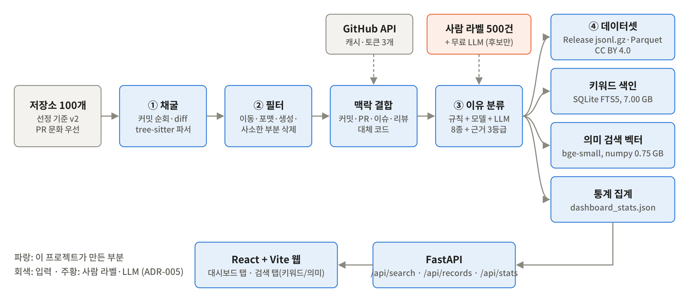
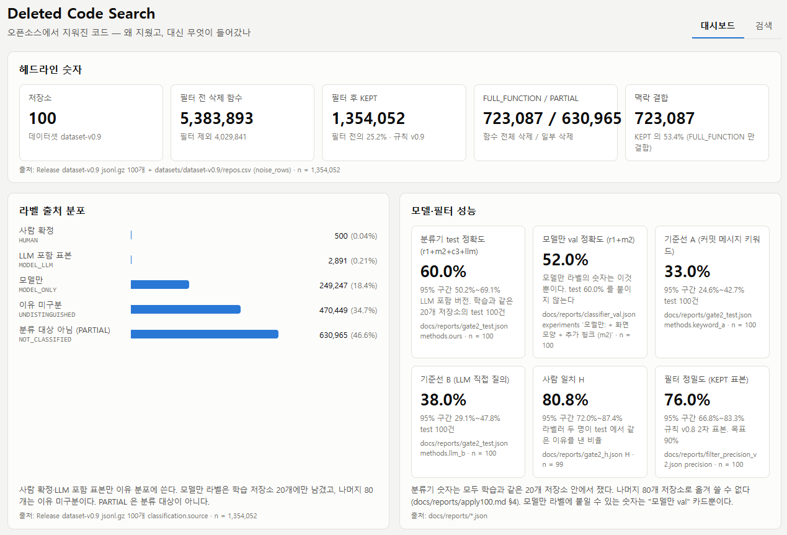
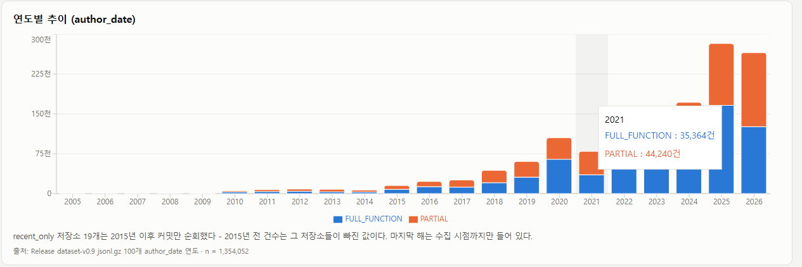
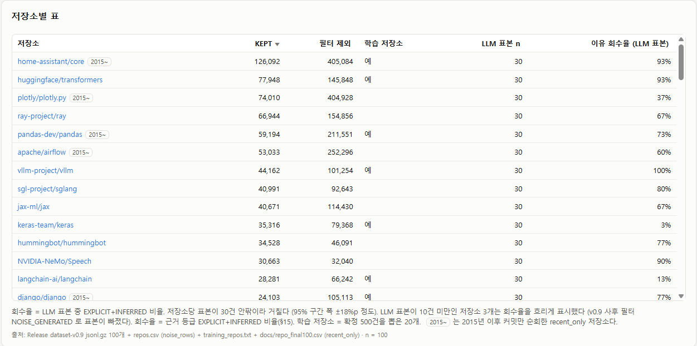
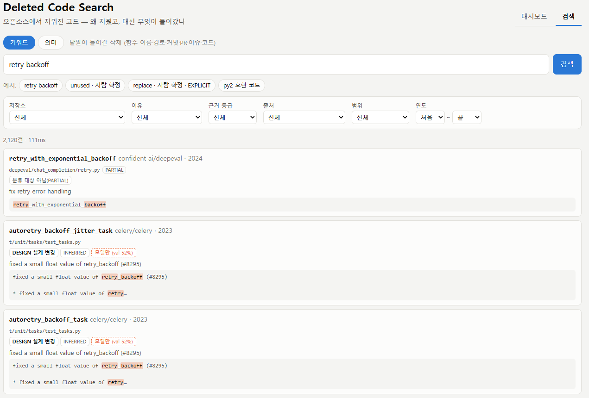
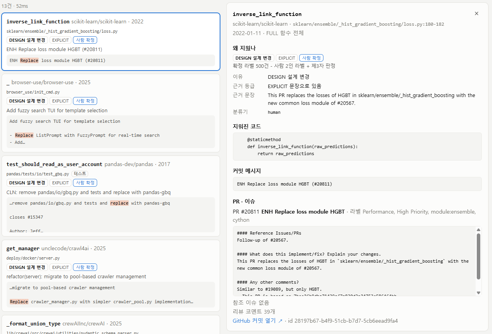
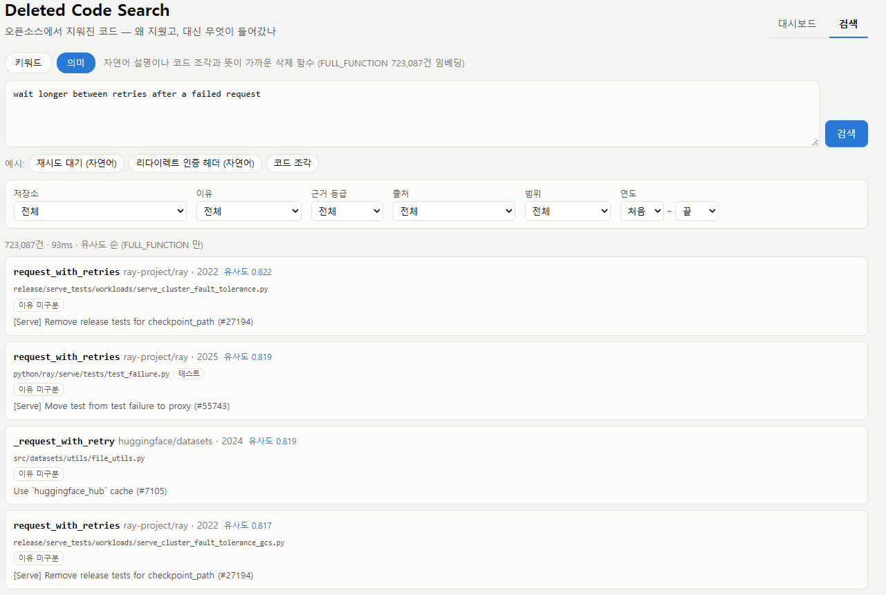
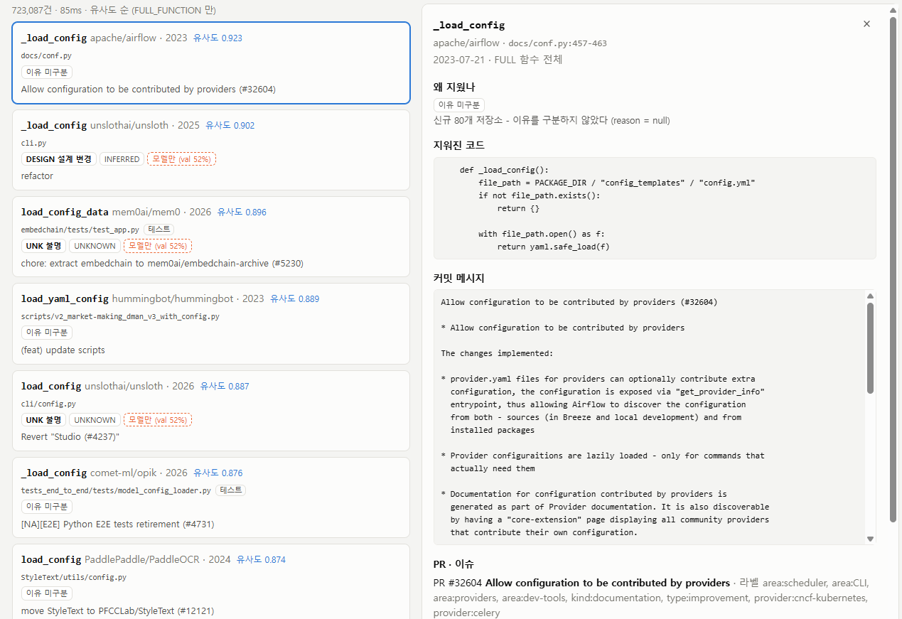
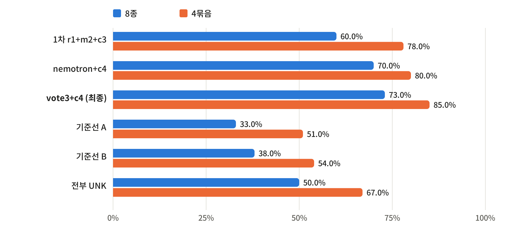

# 지워진 코드 검색엔진 (Deleted Code Search) — 결과보고서

캡스톤 페스티벌 2026 · 팀 깻잎 · 단국대학교 소프트웨어학과 · 담당교수 박규식

PDF: [report.pdf](report.pdf)

## 1. 배경과 문제 정의

### 1.1 문제

개발 지식의 절반은 "무엇을 하지 말아야 하나"인데, 그 지식은 어디에도 저장되지 않는다.

- **스택오버플로**는 "어떻게"에 답한다. "해 봤는데 안 됐다"는 답하지 않는다.
- **코드 검색**(GitHub, Sourcegraph)은 현재 상태를 색인한다. 지워진 코드는 기본 검색 대상이 아니다.
- **AI 코딩 도구**는 살아남은 코드로 학습했다. 그럴싸하지만 나중에 지워질 코드를 뱉을 수 있다.
- **삭제 이유**는 커밋 메시지·PR·리뷰에 흩어져 있고, 저장소 하나에서도 손으로 찾기 비현실적이다.

비유하면 이렇다. 깃허브가 "살아있는 코드의 도서관"이라면, 이 프로젝트는 "실패한 코드의 부검 기록"이다. 의사가 사망 원인 통계로 배우듯, 개발자가 삭제 원인으로 배운다.

### 1.2 왜 어려운가

단순한 git log 검색으로 풀리지 않는 이유가 넷 있다. 이 넷이 곧 이 프로젝트의 기술 과제다.

| 어려움 | 내용 | 다룬 곳 |
|---|---|---|
| 삭제의 단위 | diff는 줄 단위다. "함수가 지워졌다"는 AST로 경계를 찾아야 안다 | §4.1 파이프라인 |
| 삭제의 대부분은 노이즈 | 이동·리네임·포맷 변경·생성 코드. 실제로 538만 건 중 135만 건만 남았다 | §4.2 필터 |
| 이유는 코드 밖에 있다 | 커밋 메시지·PR 본문·이슈·리뷰 코멘트를 결합해야 하고, 아예 안 적힌 경우도 많다 | §4.3 맥락 결합 |
| 정답이 흔들린다 | 사람끼리도 삭제 이유가 갈린다. 2인 교차 라벨과 제3자 판정으로 정답을 확정했다 | §5.1 사람 라벨 |

### 1.3 우리 답

오픈소스 저장소 100개의 삭제 이력을 **함수 단위**로 추출하고, **삭제 이유**와 **대체 코드**를 묶어 검색 가능하게 만든다. 분류한 레코드마다 **근거 등급**을 달아 이유가 얼마나 확실한지 함께 보여 준다.

## 2. 목표와 범위

### 2.1 궁극 목표

소프트웨어 실패 지식의 검색 인프라. 모든 주요 언어·저장소를 색인하고, IDE에서 코드를 쓰는 순간 "이 패턴은 과거 N번 이런 이유로 삭제됨"을 알려주는 조기 경고 시스템이다. 이유가 기록된 오픈소스에서 삭제의 패턴을 배워, 이유가 기록되지 않은 모든 코드베이스에 그 이유를 되돌려준다.

### 2.2 핵심 4 + 확장

| 구분 | 항목 | 상태 | 결과 |
|---|---|---|---|
| 핵심 ① | 삭제 코드 채굴 파이프라인 | 완료 | 저장소 100개, 삭제 함수 5,383,893건 |
| 핵심 ② | 의미 있는 삭제 필터 | 완료 | 규칙 v0.9, KEPT 1,354,052건 |
| 핵심 ③ | 삭제 이유 분류 | 완료 | 8종 73.0% / 4묶음 85.0% |
| 핵심 ④ | 공개 데이터셋 | 완료 | Release dataset-v0.9, 확정 라벨 500건 |
| 확장 | 통계 대시보드 | 완료 | 패널 8개 |
| 확장 | 키워드 검색 + 웹 UI | 완료 | SQLite FTS5, p50 28ms · p95 388ms |
| 확장 | 의미 검색 | 완료 | P@10 0.625, p50 46ms · p95 50ms |

### 2.3 처음 목표와 결과

| 목표 | 값 | 결과 | 달성 |
|---|---|---|---|
| 대상 저장소 | 100개 | 100개 | 달성 |
| 의미 있는 삭제 | 5만 건 이상 | 1,354,052건 | 달성 |
| 검색 P@10 | ≥ 0.6 | 0.625 | 달성 |
| 검색 응답 시간 | ≤ 1초 | p95 50ms (의미), 388ms (키워드) | 달성 |
| 데이터셋·코드 공개 | 라이선스 명시 | MIT / CC BY 4.0 | 달성 |

## 3. 시스템 설계

### 3.1 전체 구조



*그림 3-1. 시스템 구조. 데이터는 왼쪽에서 오른쪽으로 한 번 흐르고, 서빙은 만들어진 파일만 읽는다.*

| 구성 요소 | 코드 | 입력 → 출력 | 담당 |
|---|---|---|---|
| 저장소 선정 | pipeline/select_repos.py | GitHub API → 저장소 목록 CSV | 홍성제 |
| 채굴 | pipeline/clone.py, walk.py, extract.py, run.py | 클론 → 삭제 함수 JSONL | 안재헌 |
| 파서 | pipeline/parsers/ | 소스 텍스트 → 함수 목록 | 안재헌 |
| 필터 | pipeline/filter.py, postfilter.py | 삭제 함수 → filter_status | 안재헌, 홍성제 |
| 맥락 결합 | pipeline/context.py | 커밋 → PR·이슈·리뷰·대체 코드 | 최희수 |
| 조립·내보내기 | pipeline/assemble.py, export.py | → Release Parquet·jsonl.gz | 안재헌 |
| 이유 분류 | classify/ | 레코드 → 이유·근거 등급 | 최희수 |
| 평가 | eval/ | 예측·라벨 → 보고서 | 홍성제, 최희수 |
| 검색·통계 | search/ | jsonl.gz → SQLite·numpy·JSON, API | 홍성제, 최희수 |
| 화면 | web/ | API → 대시보드·검색 | 홍성제 |
| 라벨링 도구 | tools/ | 표본 → 사람 라벨 | 홍성제 |

**설계 원칙 셋.** 언어 독립(파서 계층 분리), 단계마다 파일로 끊기(실패 복구와 3인 분담), 서빙은 읽기 전용(무거운 계산은 한 번만).

### 3.2 이유 8종과 근거 3등급

| 코드 | 이유 | 정의 | 코드 | 이유 | 정의 |
|---|---|---|---|---|---|
| **BUG** | 버그 수정 | 잘못된 동작을 고치려 제거 | **DEAD** | 죽은 코드 | 호출되지 않아 제거 |
| **PERF** | 성능 | 느리거나 자원을 많이 써 교체 | **DESIGN** | 설계 변경 | 구조·추상화 변경으로 제거 |
| **SEC** | 보안 | 취약점·위험한 패턴 제거 | **FEAT** | 기능 제거 | 기능 자체를 없앰 (폐기, 지원 종료) |
| **LIB** | 라이브러리 교체 | 직접 구현을 라이브러리로 대체 | **UNK** | 불명 | 어느 것으로도 판단 불가 |

| 등급 | 뜻 | 저장하는 것 |
|---|---|---|
| **EXPLICIT** | PR·이슈·커밋에 이유가 문장으로 있음 | 원문 인용 |
| **INFERRED** | 닫힌 목록 6종의 구조적 신호로 추론 (대체 코드, 호출자 변화, 테스트 변화, 공개 표면 변화, 같은 커밋의 동형 삭제, 삭제된 코드 자체) | 추론 근거, 신뢰도 |
| **UNKNOWN** | 판단 불가 | 원인 태그 |

### 3.3 기술 스택

| 영역 | 선택 |
|---|---|
| 언어 | Python 3.12 (파이프라인·분류·API), TypeScript (웹) |
| 파싱 | tree-sitter + tree-sitter-python |
| 분류 | scikit-learn (TF-IDF + 로지스틱 회귀) + LLM (NVIDIA 무료 API) |
| 검색 | SQLite FTS5 (키워드), fastembed + ONNX Runtime + numpy (의미) |
| API·웹 | FastAPI, React + Vite, recharts |
| 데이터 | JSONL·Parquet, GitHub Release |
| 품질 | pytest, ruff, GitHub Actions |

## 4. 구현

### 4.1 채굴 파이프라인

저장소를 전체 이력으로 클론하고, 기본 브랜치의 커밋을 시간순으로 돌며 부모 대비 diff에서 삭제 헝크를 뽑는다. 병합 커밋은 건너뛰어 중복을 막는다. 삭제 헝크가 tree-sitter로 찾은 함수 경계를 모두 덮으면 FULL_FUNCTION, 일부만 덮으면 PARTIAL이다.

- **언어 독립.** 파서를 어댑터로 분리해, 언어를 추가할 때 어댑터 하나만 구현한다.
- **3인 분담.** 저장소 목록을 3분할해 각자 노트북에서 돌리고 결과만 합쳤다. 실패하면 재시도하고, 조립 단계가 중복과 실패를 검사한다.
- **큰 저장소.** 최초 커밋이 2015년 이전인 19개는 2015년 이후만 채굴했다.

### 4.2 의미 있는 삭제 필터

"배울 게 있는 삭제"만 남긴다. 추출 때 적용하는 규칙과, 조립 결과에 나중에 적용하는 사후 필터로 나뉜다.

| 상태 | 규칙 | 건수 |
|---|---|---|
| NOISE_TRIVIAL | 부분 삭제 중 4줄 이하 | 2,855,071 |
| NOISE_MOVE | 같은 커밋의 다른 위치에 정규화 본문이 같거나 유사도 ≥ 0.9인 함수 | 946,350 |
| NOISE_GENERATED | site-packages·벤더·venv·*_pb2.py 경로 (사후) | 150,861 |
| NOISE_FORMAT | 포맷 커밋의 재포맷: 메시지에 포맷 키워드 + 삭제 줄 90% 이상이 재등장 (사후) | 77,559 |
| **KEPT** | **의미 있는 삭제** | **1,354,052** |
| 합계 | 필터 전 삭제 함수 | 5,383,893 |

KEPT 구성은 FULL_FUNCTION 723,087건, PARTIAL(5줄 이상) 630,965건이다.

### 4.3 맥락 결합과 대체 코드

삭제 이유는 코드가 아니라 텍스트에 적혀 있다. 함수 전체 삭제(FULL_FUNCTION 723,087건 모두)에 다음을 붙였다.

- **커밋 메시지 → PR → 이슈 → 리뷰 코멘트.** GitHub API로 조회하고 캐시한다.
- **대체 코드.** 같은 커밋·같은 파일의 추가 헝크에서 삭제 위치와 겹치는 것을 찾는다(SAME_LOCATION). 호출자 변경도 대체 신호다(CALLER_CHANGE).

### 4.4 이유 분류기

세 가지 방식을 비교하도록 처음부터 설계했다. 정답은 사람 확정 라벨이고 LLM은 정답이 되지 못한다.

| 방식 | 버전 | 어떻게 |
|---|---|---|
| 기준선 A | a1 | 커밋 메시지 키워드 규칙 |
| 기준선 B | b1 | LLM 직접 질의 (diff + 메시지) |
| 우리 방식 | r1+m2+c3 | 규칙 + 모델 + LLM 합산 |

우리 방식의 구조는 다음과 같다.

1. **LLM 후보(프롬프트 c3).** 라벨러 화면과 같은 정보와 가이드 판정 순서 요약을 주고 라벨 후보를 받는다.
2. **모델 m2.** TF-IDF + 로지스틱 회귀, UNK를 포함한 8종. 맥락 문장·함수 이름·화면 모양 낱말을 특징으로 쓴다.
3. **점수 = 모델 확률 + 0.5 × [LLM이 고른 라벨].** 가장 높은 라벨을 고른다.
4. **규칙 r1**은 근거 등급과 원문 인용에 쓴다.

**100개 적용.** 라벨마다 출처를 기록해, 사람 확정 라벨과 분류기 라벨을 구분한다.

| 출처 | 행 | 이유 칸 | 성능으로 말하는 값 |
|---|---|---|---|
| HUMAN | 500 | 사람 확정 | 정답 |
| MODEL_LLM | 2,891 | r1+m2+c3 (저장소마다 표본) | test 60.0% |
| MODEL_ONLY | 249,247 | r1+m2 (학습 저장소 20개) | val 52.0% |
| UNDISTINGUISHED | 470,449 | null, "이유 미구분" (신규 80개) | - |
| NOT_CLASSIFIED | 630,965 | null (PARTIAL은 분류 대상이 아니다) | 없음 |

### 4.5 데이터셋 공개

| 항목 | 값 |
|---|---|
| 배포 | [GitHub Release dataset-v0.9](https://github.com/Deleted-Code-Search/Deleted-Code-Search/releases/tag/dataset-v0.9) |
| 형식 | 저장소별 Parquet + 같은 행의 jsonl.gz |
| 규모 | 저장소 100개, 1,354,052행 |
| 사람 라벨 | 500건 (train 300 / val 100 / test 100), 저장소에도 main500.jsonl |
| 라이선스 | 데이터셋 CC BY 4.0, 스니펫은 원 저장소 라이선스, 행마다 출처 링크 |
| 코드 포함 | CODE_INCLUDED 1,319,661행 / LINK_ONLY 34,391행 |

**라이선스는 행 단위로 확인했다.** 저장소 라이선스는 100개 모두 permissive다. 일부 경로·시기가 다른 라이선스인 34,391행은 코드 대신 링크와 메타데이터만 낸다.

### 4.6 웹: 대시보드와 검색

데이터 없이도 대시보드는 바로 뜨고, 검색은 색인이 있으면 켜진다. 모든 패널이 출처와 표본 수를 함께 적는다. run.cmd 더블클릭으로 실행한다 (부록).



*그림 4-1. 대시보드 위쪽. 헤드라인 숫자, 라벨 출처, 모델·필터 성능.*





*그림 4-2. 연도별 추이와 저장소별 표.*



*그림 4-3. 키워드 검색(retry backoff 등). 필터 6종(저장소·이유·근거 등급·출처·범위·연도)과 매칭 강조.*



*그림 4-4. 상세 패널. 지워진 코드·커밋·PR·이슈·대체 코드·이유·근거 문장·GitHub 링크를 한곳에서 본다.*



*그림 4-5. 의미 검색. 자연어로 찾으면 낱말이 겹치지 않아도 뜻이 가까운 함수가 나온다.*



*그림 4-6. 코드 조각 검색. 이유 미구분 배지처럼 라벨 출처와 신뢰 수준을 결과마다 표시한다.*

| 기능 | 구현 |
|---|---|
| 키워드 검색 | 함수 이름·경로·커밋 메시지·PR 제목·이슈 제목·지워진 코드를 FTS5로. BM25 정렬, 구문·접두어 |
| 의미 검색 | 질의를 같은 모델로 임베딩하고 FULL_FUNCTION 723,087건과 전수 내적. 서버 시작 때 벡터를 메모리에 읽는다 |
| 정직한 표시 | 출처 배지를 항상 단다. LINK_ONLY는 코드 대신 GitHub 링크. 분류기 라벨에는 성능 숫자를 함께 표시 |

## 5. 평가

### 5.1 사람 라벨과 이유 회수율

라벨 500건은 저장소 20개에서 균등하게 뽑았고, 건마다 2인이 독립 라벨한 뒤 갈리면 제3자가 둘 중 하나를 골랐다. 2인 일치 350건 + 제3자 판정 150건이다.

| 구간 | 회수 (분모 500) | 회수율 |
|---|---|---|
| EXPLICIT만 | 110 | **22.0%** |
| EXPLICIT + INFERRED(≥0.5) — 이유 회수율 정의 | 276 | **55.2%** |
| EXPLICIT + INFERRED(≥0.8) | 121 | **24.2%** |

이유 분포는 UNK 224 · DESIGN 148 · DEAD 69 · FEAT 33 · LIB 17 · BUG 8 · SEC 1 · PERF 0이다. 등급 분포는 EXPLICIT 110 / INFERRED 166 / UNKNOWN 224다.

### 5.2 이유 분류

정답은 사람 확정 라벨이고, 평가는 test 100건으로 했다. 기준선 두 가지와 비교했다.



*그림 5-1. test 100건 정확도. 8종은 라벨과 정확히 같아야 정답, 4묶음은 비슷한 이유를 묶은 뒤 확정 라벨 또는 라벨러 라벨과 같은 묶음이면 정답이다.*

| 방식 | 버전 | 8종 | 4묶음 |
|---|---|---|---|
| 기준선 A (커밋 메시지 키워드) | a1 | 33.0% | 51.0% |
| 기준선 B (LLM 직접 질의) | b1 | 38.0% | 54.0% |
| 모두 UNK 라고 답하기 | - | 50.0% | 67.0% |
| 우리 방식 1차 | r1+m2+c3 | 60.0% | 78.0% |
| 개선: 분류기 변경 | nemotron+c4 | 70.0% | 80.0% |
| **최종: 다수결** | **vote3+c4** | **73.0%** | **85.0%** |

- **1차 분류기부터 기준선보다 통계적으로 낫다.** 짝 비교(정확 이항 검정)에서 B와 31 : 9 (p = 0.0007), A와 36 : 9 (p = 0.0001)이다.
- **원인 분석에서 개선을 시작했다.** 1차에서 틀린 40건 중 26건(65%)이 "이유 있음 vs UNK" 혼동이었다.
- **분류기 변경.** UNK 판단 기준을 더한 프롬프트 c4와 nemotron-3-ultra 모델로 8종 70.0%가 됐다.
- **다수결.** 세 답의 다수결로 8종 73.0% / 4묶음 85.0%가 됐다. 1차 대비 짝 비교는 8종 19건 : 6건 (p = 0.015)이고, UNK 혼동은 26건에서 18건으로 줄었다.
- **데이터셋 적용.** vote3+c4는 건당 5회 호출이라 전체 723,087건에 약 360만 회가 필요하다. 공개 데이터셋 라벨은 1차 분류기이며, 전체 적용은 향후 계획이다.

### 5.3 검색 관련성

질의 10개(자연어 8 + 코드 조각 2)의 두 모드 상위 10개를 합친 198행을, 모드·순위를 숨긴 블라인드 시트로 판정했다.

| 모드 | P@10 | MRR |
|---|---|---|
| 키워드 기준선 (SQLite FTS5, BM25) | 0.325 | 0.470 |
| **의미 검색** | **0.625** | **0.830** |

의미 검색이 키워드 기준선보다 P@10은 약 2배, MRR은 0.36 높고, 목표 P@10 ≥ 0.6을 달성했다. 판정 일치는 198행 중 176행(88.9%), Cohen's kappa 0.777이다. 질의 10개 중 8개에서 의미 검색이 앞섰고, q02(python 2 호환 shim)·q04(명령행 인자 파싱)처럼 정확한 낱말이 중요한 질의는 키워드가 앞섰다. 두 방식을 함께 제공하는 이유다.

### 5.4 시스템 성능

| 항목 | 값 | 목표 | 출처 |
|---|---|---|---|
| 저장소 / 실패 | 100 / 0 | 실패율 보고 | 대시보드 집계 |
| 저장소당 처리 시간 중앙값 / 최대 | 2,537.3초 / 55,000.3초 | 보고 | 같은 곳 |
| 의미 검색 응답 | p50 46ms · p95 50ms | ≤ 1초 | 의미 응답 시간 |
| 키워드 검색 응답 | p50 28ms · p95 388ms | ≤ 1초 | 키워드 응답 시간 |
| 가장 느린 키워드 질의 | get_config* 최대 656ms | ≤ 1초 | 같은 곳 |
| 서버 시작 때 모델·벡터 읽기 | 1.3초 | 보고 | 의미 응답 시간 |

## 6. 개발 과정

### 6.1 일정과 게이트

계획 단계에서 확인 지점(게이트)을 두어, 결과에 따라 무엇을 할지 미리 정해 두었다. "실패 모드는 붕괴가 아니라 축소"라는 선정 원칙을 일정으로 옮긴 것이다.

| 시기 | 한 일 | 게이트·결과 |
|---|---|---|
| 9월 2주 | 저장소 골격, CI, 라벨 가이드 v1, 저장소 20개 확정 | |
| 9월 3~4주 | 파서·필터·맥락 결합, 예비 200건 라벨 | 게이트 1: 진행 |
| 9월 말~10월 초 | 20개 실행, 필터 검증, 가이드 v3 | |
| 10월 중순 | 라벨 500건 확정, 저장소 100개 선정·실행, 분류기, 기준선 | 게이트 2: test 1회 측정 |
| 10월 말 | 100개 적용, 사후 필터 v0.9, 데이터셋 공개, 대시보드, 검색 1·2단계 | |
| 11월 초 | 관련성 판정, 분류기 개선, 문서 정리, 제출 자료 | P@10 0.625, 분류 73.0% |

**게이트 1 판정.** 예비 200건의 세 구간 판정이 37.5% / 73.5% / 44.0%로 갈렸다. 라벨러 불일치를 양 극단으로 해소한 범위를 분석해, 판정이 바뀌지 않는 구간이 이유 회수율 정의와 같은 구간(73.5~95.5%) 하나임을 확인하고 "진행"으로 판정했다.

**게이트 2 판정.** test 100건을 한 번만 돌려 1차 분류기를 측정했고, 미리 정한 대응(분류기 라벨과 사람 라벨 구분, 핵심 산출물을 확정 라벨과 통계로)을 따랐다. 이후 분류기 개선은 §5.2에 있다.

### 6.2 사전 등록

평가를 고칠 수 있는 사람이 평가하는 문제를 막으려고, 기준을 결과 전에 커밋했다. 커밋 시각이 증거다.

| 사전 등록 | 언제 | 무엇을 막았나 |
|---|---|---|
| 게이트 1 측정 방법 | 라벨링 전 | 구간 경계를 결과에 맞추는 일 |
| 게이트 2 기준 | 500건 라벨 전 | 기준을 결과에 맞추는 일 |
| H 기록 | test 실행 전 | 사람 일치율을 결과 뒤에 해석하는 일 |
| 라벨링 v3 | 51~100번 라벨링 전 | "kappa가 나올 때까지 기준을 고치는" 고리 |
| 결과별 대응 | test 실행 전 | 결과를 보고 대응을 고르는 일 |

### 6.3 도그푸딩

우리 저장소도 우리 도구의 분석 대상이 될 수 있게 운영했다. PR·이슈를 강제하고, 코드를 삭제하는 커밋은 본문에 이유를 쓰게 했다. 그래야 우리 도구가 EXPLICIT을 낼 수 있다.

## 7. 활용과 확장 계획

이 장은 구축한 데이터셋과 검색 엔진을 바탕으로 한 활용과 확장 방향이다.

### 7.1 대상 고객과 활용 장면

| 고객 | 지금 겪는 문제 | 우리가 주는 것 | 첫 접점 |
|---|---|---|---|
| **시니어 리뷰어 없는 개발자·소규모 팀·학생** | 내 코드가 나중에 지워질 패턴인지 물어볼 사람이 없다. 우리 팀이 정확히 여기 해당한다 | 검색: 비슷한 코드를 남들이 왜 지웠는지 | 무료 웹 검색 → VS Code 플러그인 |
| **AI 코딩 도구로 짠 코드를 검증하려는 기업** | AI 도구는 살아남은 코드로 학습해, 그럴싸하지만 나중에 지워질 코드를 낼 수 있다. 리뷰 부담이 늘어난다 | 진단: AI가 낸 코드와 유사한 삭제 이력과 이유 분포 | 검색·진단 API → 사내 저장소 분석 |
| **연구자 (MSR, 소프트웨어 공학)** | 삭제 이유 연구마다 데이터를 새로 모으고 라벨한다 | 함수 단위 삭제 + 이유 + 대체 코드 데이터셋, 사람 확정 라벨 500건 | CC BY 4.0 공개 데이터셋 |

사용 장면은 다음과 같다.

1. 재시도 로직을 직접 짜려는 개발자가 retry backoff를 검색한다. 같은 방식을 썼다가 지운 프로젝트들의 코드와 이유, 대체 코드를 확인한다.
2. 연구자가 파이썬 프로젝트의 삭제 이유 분포 데이터를 논문에 쓴다.
3. 같은 데이터로 PR 전 코드 진단, AI가 만든 코드 검증, 개인 저장소의 삭제 이유 추정까지 넓혀 갈 수 있다.

### 7.2 경쟁과 차별점

선행 조사 결과를 비교 축으로 정리했다.

| | 지워진 코드 찾기 | 함수 단위 | 삭제 이유 | 대체 코드 | 의미 검색 | 여러 저장소 | 도구로 사용 |
|---|---|---|---|---|---|---|---|
| **Sourcegraph diff 검색** | 예 (정규식) | 아니오 | 아니오 | 아니오 | 아니오 | 예 | 예 |
| **fossil-code** | 예 | 죽은 코드 탐지 | 설명 있음 | 아니오 | 아니오 | **아니오 (내 저장소 1개)** | 예 (CLI) |
| **deadcode-archaeologist** | 예 | fossil-code와 같은 계열 | 설명 있음 | 아니오 | 아니오 | **아니오** | 예 (CLI) |
| **MSR 학술 연구** | 연구마다 다름 | 연구마다 다름 | 통계 | 아니오 | 아니오 | 예 | **아니오 (논문)** |
| **Software Heritage** | 아카이브 | 아니오 | 아니오 | 아니오 | 아니오 | 예 | 아카이브 |
| **우리** | **예** | **예** | **8종 + 근거 등급** | **예** | **예** | **예 (100개)** | **예 (웹·데이터셋)** |

- **목적이 다르다.** fossil-code 계열은 **내 저장소 청소** 도구다. 우리는 **남의 저장소 100개에서 배우는** 검색엔진이다.
- **"모른다"를 표시한다.** 모든 결과에 근거 등급과 라벨 출처(사람 확정 / 분류기 버전)를 붙인다. 분류기 라벨에는 성능 숫자를 함께 보여 준다.
- **선점한 자산은 데이터다.** 선행 조사에서 "삭제 함수 + 이유 + 대체 코드" 데이터셋과 크로스 저장소 삭제 코드 의미 검색을 찾지 못했다. 사람 확정 라벨 500건과 함께 공개한 것이 그 기록이다.

### 7.3 수익모델과 확장 단계

무료 데이터셋과 검색으로 사용자를 모은 뒤 개인 구독, API, 기업용 순으로 확장할 수 있는 구조다.

| 수익원 | 무엇을 파나 | 고객 | 과금 단위 |
|---|---|---|---|
| **VS Code 플러그인 구독** | 코드를 쓰는 순간 유사 삭제 이력과 이유 분포 경고 | 개인 개발자, 소규모 팀 | 사용자당 월 구독 |
| **기업 사내 저장소 분석 (B2B SaaS)** | 사내 저장소의 삭제 이력·이유 통계, 사내 규칙 검색. 코드가 밖으로 나가지 않는 설치형 포함 | AI 코딩 도구를 도입한 기업 | 조직·저장소 규모별 계약 |
| **검색·진단 API 유료 호출** | 다른 도구(코드 리뷰 봇, AI 코딩 도구)가 부르는 삭제 이력 조회 | 개발 도구 회사, 기업 | 호출 수 |
| **데이터셋 상업 라이선스** | 공개판에 없는 것: 개선 분류기 라벨, 정기 갱신, 추가 언어, 납품 형식과 지원 | AI·개발 도구 회사 | 판본·연 단위 계약 |


*그림 7-1. 사업화 4단계.*

| 단계 | 내용 | 필요한 것 |
|---|---|---|
| **1단계 MVP** (완료) | 파이썬 저장소 100개, 데이터셋·대시보드·검색 | 노트북 3대, 무료 API, 팀 3명 |
| **2단계 확대** | 두 번째 언어 어댑터(JS/TS), 저장소 확대 | 언어별 사람 라벨, 유료 LLM 또는 서버 |
| **3단계 IDE** | 진단 API, VS Code 플러그인 | 호스팅 서버, 플러그인 개발 |
| **4단계 기업용** | 사내 저장소 분석, API 유료화 | 설치형 패키징, 보안 검토, 첫 고객 |

1단계 MVP는 서버 없이 노트북 3대와 무료 API로 완성했고 현금 비용은 0원이다. 의미 검색은 72만 건 전수 내적이 50ms 안에 끝나 작은 서버 한 대로 서비스를 시작할 수 있다.

### 7.4 향후 계획

우선순위 순이다.

1. **개선 분류기를 데이터셋 전체에 적용.** 약 360만 회 호출이 필요해 유료 API 또는 표본 적용을 검토한다.
2. **새 데이터로 분류기 검증과 일반화.** 학습 저장소 밖 신규 80개도 구체적인 이유를 낼 수 있게 한다.
3. **사용자 평가**(개발자 10명)와 검색 평가 확대(질의 30개, 정규식 기준선)를 계획한다.
4. **필터 규칙 고도화.** 제자리 재작성 탐지 등을 계획한다.
5. **맥락 쪽 개선.** 대체 코드 매칭과 호출자 신호를 강화할 계획이다.
6. **확장 순서.** 코드 진단 API → VS Code 플러그인 → 개인 저장소 이유 추정 → 두 번째 언어 순으로 확장할 수 있다.

## 8. 팀 구성과 역할

| 이름 | 역할 | 담당 영역 | 경로 |
|---|---|---|---|
| **홍성제** (조장) | 프로덕트·평가 | 저장소 선정, 라벨링 총괄·교차 검증, 평가 계획 실행, 게이트 판정, 통계 대시보드·웹, 검색 색인·임베딩 구현, 회의록·설계 문서·제출 문서, 발표 | web/, docs/, eval/, tools/, search/(공동) |
| **안재헌** | 파이프라인 | 클론·커밋 순회, 파서 계층, 의미 있는 삭제 필터, AST 정규화, 병렬화·실패 복구, 조립, 데이터셋 내보내기 | pipeline/ (context.py 제외) |
| **최희수** | 분류·검색 | 맥락 결합(GitHub API·PR·이슈·리뷰), 대체 코드 매칭, 이유 분류기, 기준선 A/B, 100개 적용, 검색 관련성 판정 | pipeline/context.py, classify/, search/(공동) |

## 9. AI 코딩 도구 활용

AI 코딩 도구(Claude Code)는 구현을 돕는 데 썼고, 결과 품질을 좌우하는 부분은 팀이 직접 설계하고 고쳤다.

| 영역 | AI 코딩 도구 활용 | 팀이 한 일 |
|---|---|---|
| **의미 있는 삭제 필터** | 1차 구현 | 538만 건 중 무엇을 남길지 정하는 핵심 단계라, 실제 삭제 사례를 보며 규칙을 여러 차례 직접 수정·추가하고 버전별로 관리했다 |
| **파이프라인·맥락 결합** | 테스트 작성 보조 | 처리 흐름과 데이터 스키마 설계 및 구현, 결과 검증 |
| **이유 분류기** | 실험 스크립트 작성 보조 | 8종 이유·3단계 근거 등급 정의, 오답 40건 분석, 프롬프트 기준과 다수결 방식 결정 |
| **웹 대시보드·검색 화면** | 화면 코드 대부분 작성 | 화면 구성과 보여 줄 지표 결정 |

PR 자동 리뷰에는 CodeRabbit을 써서, 사람 리뷰 전에 1차로 결함을 걸렀다.

라벨링 가이드, 사람 라벨 500건(2인 교차 후 제3자 판정), 평가 계획 사전 등록과 게이트 판정은 도구 없이 팀이 직접 했다. 도구가 만든 코드는 담당 팀원이 읽고 이해한 뒤에만 커밋했고, 모든 변경은 다른 팀원의 PR 검토와 테스트 통과 후 병합했다. LLM 출력은 정답 라벨로 쓰지 않았다.

## 부록. 실행 방법과 코드

### 실행 방법

저장소 루트에서 실행한다. 필요한 것은 Python 3.12, Node.js 20 이상이다. 대시보드는 데이터 없이 뜨고, 검색은 Release 데이터가 있으면 색인을 만들어 켠다. 자세한 내용은 저장소 README에 있다.

탐색기에서 run.cmd를 더블클릭한다. 터미널에서는 다음과 같다.

```powershell
.\run.cmd
```

### 코드

| 경로 | 내용 |
|---|---|
| pipeline/ | 채굴·파서·필터·맥락 결합·조립·내보내기 |
| classify/ | 이유 분류기, 기준선 A/B |
| search/ | 색인·임베딩·검색·통계 API |
| eval/ | 평가·게이트 판정 |
| tools/ | 라벨링 CLI |
| web/ | React 대시보드·검색 |
| datasets/ | 확정 라벨 500건, 공개 데이터셋 문서 |
| tests/ | pytest |

### 공개 자료

- 데이터셋: [Release dataset-v0.9](https://github.com/Deleted-Code-Search/Deleted-Code-Search/releases/tag/dataset-v0.9)
- 라이선스: 코드 MIT, 데이터셋 CC BY 4.0, 스니펫은 원 저장소 라이선스
